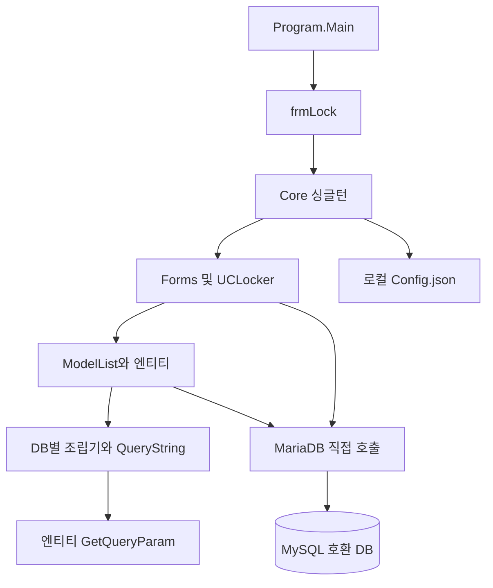

# 01. 시스템 개요

## 분석 범위와 근거

- 기준 커밋: `30cdc19992182d3216e1f855fe6a8e4ecb1dea53`, 분석일: 2026-09-14.
- 저장소의 C# 구현, Designer, 프로젝트 참조, SQL 생성 코드와 DDL을 정적으로 분석했다. 실행 프로그램·운영 DB·실데이터는 확인하지 않았다. 문서 외 기존 파일은 변경하지 않았다.
- 이 문서군의 소스 경로는 별도 접두사가 없으면 Y3/Y3/ 기준이다. 메서드명과 `파일:행`은 해당 커밋의 근거 위치다. **추정**은 별도로 표시한다. 미확인은 제품에 절대 없다는 의미가 아니라 이 저장소에서 구현을 찾지 못했다는 의미다.

## 솔루션과 프로젝트

`Y3/Y3.sln`에는 `Y3/Y3/Y3.csproj` 한 개가 있다. Visual Studio 17 형식, Debug/Release, Any CPU 구성이다. 프로젝트는 .NET Framework 4.7.2의 C# Windows Forms `WinExe`, 출력 어셈블리는 `Y3GYM`이다. 어셈블리 버전은 1.0.0.2다. 별도 서버·웹·테스트·도메인 라이브러리 프로젝트는 없다.

근거: [솔루션](../../Y3/Y3.sln), [프로젝트](../../Y3/Y3/Y3.csproj), `Properties/AssemblyInfo.cs:35`(이하 `Y3/Y3/` 하위).

## 디렉터리

| 위치 | 역할 |
| --- | --- |
| `Y3/Y3/Program.cs` | 중복 프로세스 실행 검사, WinForms 초기화, 로그인 폼 실행 |
| `Forms/frmLock.cs`, `Forms/frmMain.cs` | 로그인, 메뉴·자식 폼 호스팅, 락커 현황 |
| `Forms/Setting` | 회원·트레이너, 세션 가격·개별 지급률, 빈 기타 설정 폼 |
| `Forms/Session` | 진행 세션 기록, 트레이너 매출 입력, 월·연 정산 현황 |
| `Forms/Finance` | 자산 통계, 거래 입력, 자산·분류·고정 거래 설정 |
| `Forms/admin` | 센터와 로그인 계정 관리 |
| `Forms/Popup` | 락커 편집, 소유자 선택, 미연결 급여 팝업 |
| `UserControls` | `UCLocker` 번호·사용자·만료 상태 표현 |
| `Models` | 엔티티, SQL 값 생성, 중첩 List 클래스 13개를 담은 `ModelList` |
| `Models/Finance` | 자산·분류·거래·고정 거래 모델 |
| `Models/DB` | SQL 템플릿과 테이블별 SQL 조립기 |
| `Interface` | `IDBModel`, `IDBsql`, `IModelList` 계약 |
| `Cores` | 전역 `Core`, DB 연결 및 명령 실행 |
| `Utility` | 날짜·전화번호 관련 보조 기능, DPAPI, 싱글턴, 설정, DB 버전 동기화 |
| `Utility/Version/sql` | 13개 테이블 생성 스크립트 1개 |
| `Properties`, `Resources`, `*.resx` | 어셈블리·리소스·폼 디자인 자원 |
| `Controller` | csproj의 폴더 선언만 존재, 컨트롤러 구현 없음 |
| `Y3/packages.7z` | 패키지 압축 파일; 내부 바이너리는 분석하지 않음 |

## 사용 기술

| 기술 | 저장소에서 확인한 사용 |
| --- | --- |
| .NET Framework 4.7.2 / Windows Forms / Drawing | 모든 화면과 그리드·이벤트 처리 |
| Windows Forms DataVisualization | `frmFinanceMain.UpdateChart`의 자산 차트 |
| MySql.Data 8.0.33 | `MariaDB`의 MySqlConnection, MySqlCommand, MySqlDataAdapter |
| Newtonsoft.Json 13.0.3 | 설정 직렬화 및 DataTable ↔ 모델 변환 |
| Microsoft.Office.Interop.Excel 15.0 참조 | `frmMain.ReadExcelData`에 COM 가져오기 구현. 호출 경로는 미확인 |
| System.Security / ProtectedData | Windows CurrentUser 범위로 계정 암호 암복호화 |
| user32.dll | 창 이동 및 Excel 프로세스 식별 |
| BouncyCastle 1.9.0, Protobuf 3.21.9, LZ4 1.3.5, xxHash 1.0.8 등 | 패키지/어셈블리 참조 확인. 업무 연동 기능으로 단정하지 않음 |

버전은 csproj/packages.config의 참조 선언 기준이며 실제 설치·실행 버전은 미확인이다. 최신성·보안 취약점 평가는 범위 밖이다. 근거: `Y3.csproj`, `packages.config`, `Cores/Database/MariaDB.cs`, `Cores/Core.cs`.

## 실제 계층 구조

폴더 수준 분리는 있으나 논리 계층은 강하게 섞여 있다. 폼에 잔여 횟수 검증, 수업 금액 계산, 거래 취소와 잔액 변경이 있다. 모델은 `Core.LOGIN_USER`, SQL 문자열, `ComboBox`, `MessageBox`에 의존한다. `Core.CheckFixedTransaction`은 거래의 잔액 처리를 `FORM_FINANCE_INPUT.UpdateAccount`에 위임한다. UI와 무관한 독립 비즈니스 서비스 계층은 확인되지 않는다.

**추정: 아키텍처는 상태를 가진 단일 WinForms 애플리케이션이 DB에 직접 접근하는 2-tier 구조이며, 전역 서비스 로케이터와 테이블별 게이트웨이를 혼합한 형태다.** MVC/MVVM 또는 엄격한 계층형 구조로 보기 어렵다.

근거: `Cores/Core.cs:68,80,167`, `Models/ModelList.cs:995`, `Models/User.cs:45`, `Forms/Session/frmSessionRegister.cs:229`, `Forms/Finance/frmFinanceInput.cs:318`.

## 시작과 데이터 수명

`Program.Main` → `frmLock` → `Core.InitCore`(폴더·설정·DB·버전 검사) → `ModelList` 생성(센터·계정 로드) → 로그인 → 센터별 데이터 로드 → 폼 일괄 생성 → 고정 거래 검사 → 메인 표시다. `Core`는 현재 계정·센터·설정·폼·모델 목록을 프로세스 전체에서 공유한다.

회원·트레이너의 `GetDataTable`은 DB를 다시 읽지만 세션·매출 등은 캐시 목록을 사용한다. 가계부 내역은 월 범위 SQL로 다시 읽는다. 따라서 화면을 다시 연다고 모든 데이터가 동일하게 최신화되지는 않는다. 종료 메뉴는 설정 저장 후 `Application.Exit`을 호출한다.

근거: `Program.cs:17`, `frmLock.cs:21,89`, `ModelList.cs:274,347,896,970,976`, `Core.cs:143`.

## 역검증 보완 (2026-09-15)

C# 파일은 80개이며 프로젝트 Compile 선언은 79개다. Utility/Define/Defines.cs는 파일은 있으나 Compile 항목에 없으므로 현재 빌드에 포함된 코드로 분류하지 않는다. 개인 매출등록 폼은 생성되지만 InitComboEvent 호출이 없어 트레이너 목록이 연결되지 않는다. 근거: Y3.csproj, Core.InitForm(80행), frmTrainerSales 생성자(28행), InitComboEvent(52행). 기능 구현과 정상 화면 실행 가능성을 구분한다.
