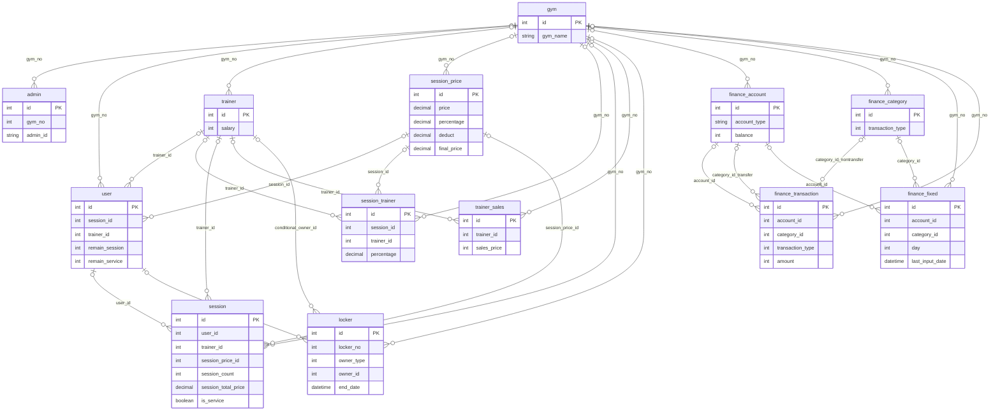

# 05. 데이터베이스 모델

## 범위

저장소 DDL은 **13개 테이블**을 정의한다. 운영 DB의 실제 스키마는 확인하지 않았다. 근거: [CreateTable.sql](../../Y3/Y3/Utility/Version/sql/CreateTable.sql), [QueryString.cs](../../Y3/Y3/Models/DB/QueryString.cs), `Models/DB/DB*.cs`, `Models/*.cs`, `Models/Finance/*.cs`.

모든 PK는 자동 증가 정수 id다. InnoDB/utf8mb4 선언이며, id 외 컬럼은 nullable이다. **명시적 FK, 업무 UNIQUE, CHECK, PK 외 인덱스, 트리거, 저장 프로시저 정의는 DDL에 없다.** C#에서도 StoredProcedure/CALL 호출은 확인되지 않았다. 운영 DB에 별도 객체가 존재하는지는 미확인이다.

## 테이블과 논리 관계

| 테이블 | 역할 / 주요 참조 |
| --- | --- |
| gym | 센터 기준 정보 |
| admin | 로그인 계정, gym_no → gym.id |
| user | 회원, gym_no → gym, trainer_id → trainer, session_id → session_price |
| trainer | 직원 기본정보·기본급, gym_no → gym |
| session_price | 종류·가격·지급률·공제율·지급단가, gym_no → gym |
| session_trainer | 종류별 개별 지급률, session_id → session_price, trainer_id → trainer |
| session | 진행 기록, user_id → user, trainer_id → trainer, session_price_id → session_price |
| trainer_sales | 수동 매출, trainer_id → trainer |
| locker | 현재 락커 배정, owner_id → 회원 또는 트레이너(조건부) |
| finance_account | 자산/카드 장부 잔액 |
| finance_category | 수입·지출 등의 분류 |
| finance_fixed | 고정 장부 설정, account_id → finance_account, category_id → finance_category |
| finance_transaction | 거래, account_id → finance_account; category_id는 분류 또는 이체 도착 자산 |

gym 이외 12개 테이블 모두 gym_no가 있다. 위 화살표는 실제 FK가 아닌 코드상 의미다. User.SessionId와 SessionTrainer.SessionId는 수업 기록 session.id를 참조하지 않는다. 근거: `frmSettingUser.UpdateUser`, `frmSettingSession.UpdateST`, `ModelList.GetSessionTrainerTotalPrice`.

## 논리적 ERD

선은 코드의 참조 관계다. 0이나 누락된 부모가 가능한 표현이므로 부모 관계를 선택적으로 표시했다. 다형 소유자 및 이체의 분류/자산 관계는 조건부다. 업무상 1인 1락커 검사는 있으나 DB에서 복수 행이 가능하므로 복수로 표시한다.

finance_fixed가 생성한 거래에는 fixed_id가 없다. 계약·예약·결제·출석 테이블도 이 DDL에는 없다.

## 코드상 JOIN

| SQL 상수 | 실제 SELECT JOIN | 주의 |
| --- | --- | --- |
| QUERY_SELECT_USER | user u LEFT JOIN locker l ON u.id=l.owner_id AND l.owner_type=1 | u.gym_no만 센터 필터. enum USER=2와 불일치 |
| QUERY_SELECT_TRAINER | trainer t LEFT JOIN locker l ON t.id=l.owner_id AND l.owner_type=2 | enum TRAINER=3과 불일치 |
| QUERY_SELECT_ADMIN | admin a LEFT JOIN gym g ON a.gym_no=g.id | admin 활성 조건만 있고 gym 활성 조건 없음 |
| QUERY_SELECT_TRANSACTION | 거래.account_id=자산.id, 거래.category_id=분류.id 및 별도 자산.id | IF(transaction_type=3,도착자산명,분류명) |
| QUERY_SELECT_FIXED_TRANSACTION | account_id=자산.id, category_id=분류.id | 부모 useflag 조건 없음 |

근거: `QueryString.cs:12–32`. 세션·매출 집계는 폼과 ModelList의 LINQ를 사용한다. 거래 조회는 시작일 이상/종료일 미만이다.

UPDATE JOIN은 대부분 관계 테이블 JOIN이 아니라 입력 SELECT/UNION ALL로 만든 파생 테이블과 PK를 연결한다. 회원·트레이너·세션류·락커는 id+gym_no, 금융 및 admin/gym 일부는 id만 매칭한다. 모델의 GetQueryParam이 문자열을 직접 보간한다.

## 모델과 DDL의 차이

- User.LockerNo와 Trainer.LockerNo는 JOIN 결과이며 원본 테이블 컬럼이 아니다.
- Admin.GymName, Account.AccountTypeName, 금융 모델의 TransactionName/AccountName/CategoryName 등은 조회·표시용이다.
- Gym은 BasicDBModel을 상속하지만 gym 테이블에 gym_no는 없다.
- user/trainer/session/session_price/session_trainer/trainer_sales/finance_transaction의 useflag는 해당 모델에 속성이 없고 SELECT/DELETE SQL에서 처리한다.
- finance_account.account_type은 DDL varchar(45), C#은 eAccountType이며 숫자를 저장한다.
- owner_type은 DDL 주석 회원=0/트레이너=1, SELECT는 1/2, enum은 NONE=1/USER=2/TRAINER=3이다. 실제 저장값을 조사하기 전 통일된 의미를 단정하지 않는다.
- Locker.StartDate와 FixedTransaction.UpdateDate는 필드가 있지만 정상 저장 폼에서 값 지정이 확인되지 않는다.
- ID 옆 이름 복제는 과거 명칭 보존 목적일 수 있다는 **추정**만 가능하다. 일괄 명칭 동기화는 미확인이다.

## 트랜잭션 및 정합성

| 위치 | 커밋 범위 | 범위 밖 작업 |
| --- | --- | --- |
| MariaDB.Save:109 | 단일 SQL 명령과 LastInsertedId | 후속 다른 모델 저장 |
| MariaDB.MultiSave:135 | 한 연결에서 1000건씩 반복 실행한 목록 | 회원 잔여, 다른 MultiSave |
| MariaDB.ExecuteQuery:85 | 전달 SQL 명령 실행 | DDL 원자성은 서버 동작 확인 필요 |

명시적 Rollback 호출은 없고 예외 시 using 해제 경로를 따른다. Save/Get 등의 예외는 대부분 삼킨다. GetDataByQueryString은 예외가 전파된다. 업무 범위에서 같은 트랜잭션을 공유하는 코드, 행 잠금, 버전 열, 조건부 잔여 갱신은 확인되지 않았다.

필수값·중복·잔여 검사는 주로 폼과 캐시에서 한다. 수업+차감, 삭제+복원, 거래+잔액, 고정 거래+최근 입력일은 별도 저장이다. 부모 비활성 시 자식 검사, 잔액 대사, 횟수 변경 원장, 고정 거래 중복 키는 없다. 세부 위험은 [11](11-risks-and-unknowns.md) 참조.

## 전체 컬럼 사전

아래는 저장소 DDL에서 추출한 타입·기본값이다. SQL 주석은 분리했으며 의미는 위 관계표와 [도메인 모델](02-domain-model.md)·[용어집](12-glossary.md)을 함께 참조한다. 이 목록은 실제 운영 DB introspection 결과가 아니다.

### admin

| 컬럼 | DDL 타입·제약·기본값 |
| --- | --- |
| id | `int NOT NULL AUTO_INCREMENT` |
| gym_no | `int DEFAULT NULL` |
| admin_id | `varchar(45) DEFAULT NULL` |
| admin_pw | `varchar(500) DEFAULT NULL` |
| last_visit_date | `datetime DEFAULT NULL` |
| useflag | `tinyint DEFAULT '1'` |

### gym

| 컬럼 | DDL 타입·제약·기본값 |
| --- | --- |
| id | `int NOT NULL AUTO_INCREMENT` |
| gym_name | `varchar(45) DEFAULT NULL` |
| useflag | `tinyint DEFAULT '1'` |

### locker

| 컬럼 | DDL 타입·제약·기본값 |
| --- | --- |
| id | `int NOT NULL AUTO_INCREMENT` |
| gym_no | `int DEFAULT NULL` |
| locker_no | `int DEFAULT NULL` |
| owner_type | `int DEFAULT '0'` |
| owner_id | `int DEFAULT NULL` |
| owner_name | `varchar(20) DEFAULT NULL` |
| start_date | `datetime DEFAULT NULL` |
| end_date | `datetime DEFAULT NULL` |

### session

| 컬럼 | DDL 타입·제약·기본값 |
| --- | --- |
| id | `int NOT NULL AUTO_INCREMENT` |
| gym_no | `int DEFAULT NULL` |
| date | `datetime DEFAULT NULL` |
| trainer_id | `int DEFAULT NULL` |
| trainer_name | `varchar(20) DEFAULT NULL` |
| user_id | `int DEFAULT NULL` |
| user_name | `varchar(20) DEFAULT NULL` |
| session_price_id | `int DEFAULT NULL` |
| session_price_name | `varchar(20) DEFAULT NULL` |
| session_count | `int DEFAULT NULL` |
| session_total_price | `decimal(10,2) DEFAULT NULL` |
| is_service | `tinyint DEFAULT '0'` |
| useflag | `tinyint DEFAULT '1'` |

### session_price

| 컬럼 | DDL 타입·제약·기본값 |
| --- | --- |
| id | `int NOT NULL AUTO_INCREMENT` |
| gym_no | `int DEFAULT NULL` |
| session_name | `varchar(20) DEFAULT NULL` |
| price | `decimal(12,2) DEFAULT NULL` |
| percentage | `decimal(4,2) DEFAULT NULL` |
| deduct | `decimal(4,2) DEFAULT NULL` |
| final_price | `decimal(12,2) DEFAULT NULL` |
| useflag | `tinyint DEFAULT '1'` |

### session_trainer

| 컬럼 | DDL 타입·제약·기본값 |
| --- | --- |
| id | `int NOT NULL AUTO_INCREMENT` |
| gym_no | `int DEFAULT NULL` |
| session_id | `int DEFAULT NULL` |
| session_name | `varchar(20) DEFAULT NULL` |
| trainer_id | `int DEFAULT NULL` |
| trainer_name | `varchar(20) DEFAULT NULL` |
| percentage | `decimal(4,2) DEFAULT NULL` |
| useflag | `tinyint DEFAULT '1'` |

### trainer

| 컬럼 | DDL 타입·제약·기본값 |
| --- | --- |
| id | `int NOT NULL AUTO_INCREMENT` |
| gym_no | `int DEFAULT NULL` |
| name | `varchar(20) DEFAULT NULL` |
| birthday | `datetime DEFAULT NULL` |
| phone_number | `varchar(30) DEFAULT NULL` |
| salary | `int DEFAULT NULL` |
| memo | `varchar(300) DEFAULT NULL` |
| useflag | `tinyint DEFAULT '1'` |

### trainer_sales

| 컬럼 | DDL 타입·제약·기본값 |
| --- | --- |
| id | `int NOT NULL AUTO_INCREMENT` |
| gym_no | `int DEFAULT NULL` |
| trainer_id | `int DEFAULT NULL` |
| trainer_name | `varchar(20) DEFAULT NULL` |
| sales_date | `datetime DEFAULT NULL` |
| sales_price | `int DEFAULT NULL` |
| memo | `varchar(300) DEFAULT NULL` |
| useflag | `tinyint DEFAULT '1'` |

### user

| 컬럼 | DDL 타입·제약·기본값 |
| --- | --- |
| id | `int NOT NULL AUTO_INCREMENT` |
| gym_no | `int DEFAULT NULL` |
| name | `varchar(20) DEFAULT NULL` |
| birthday | `datetime DEFAULT NULL` |
| phone_number | `varchar(30) DEFAULT NULL` |
| session_id | `int DEFAULT NULL` |
| session_name | `varchar(20) DEFAULT NULL` |
| remain_session | `int DEFAULT NULL` |
| remain_service | `int DEFAULT NULL` |
| trainer_id | `int DEFAULT NULL` |
| trainer_name | `varchar(20) DEFAULT NULL` |
| memo | `varchar(300) DEFAULT NULL` |
| useflag | `tinyint DEFAULT '1'` |

### finance_account

| 컬럼 | DDL 타입·제약·기본값 |
| --- | --- |
| id | `int(11) NOT NULL AUTO_INCREMENT` |
| gym_no | `int(11) DEFAULT NULL` |
| name | `varchar(45) DEFAULT NULL` |
| account_type | `varchar(45) DEFAULT NULL` |
| balance | `int(11) DEFAULT NULL` |
| useflag | `tinyint(4) DEFAULT 1` |

### finance_category

| 컬럼 | DDL 타입·제약·기본값 |
| --- | --- |
| id | `int(11) NOT NULL AUTO_INCREMENT` |
| gym_no | `int(11) DEFAULT NULL` |
| transaction_type | `int(11) DEFAULT NULL` |
| name | `varchar(45) DEFAULT NULL` |
| memo | `varchar(500) DEFAULT NULL` |
| useflag | `tinyint(4) DEFAULT 1` |

### finance_fixed

| 컬럼 | DDL 타입·제약·기본값 |
| --- | --- |
| id | `int(11) NOT NULL AUTO_INCREMENT` |
| gym_no | `int(11) DEFAULT NULL` |
| transaction_type | `int(11) DEFAULT NULL` |
| account_id | `int(11) DEFAULT NULL` |
| category_id | `int(11) DEFAULT NULL` |
| name | `varchar(100) DEFAULT NULL` |
| amount | `int(11) DEFAULT NULL` |
| day | `int(11) DEFAULT NULL` |
| last_input_date | `datetime DEFAULT NULL` |
| update_date | `datetime DEFAULT NULL` |
| useflag | `tinyint(4) DEFAULT 1` |

### finance_transaction

| 컬럼 | DDL 타입·제약·기본값 |
| --- | --- |
| id | `int(11) NOT NULL AUTO_INCREMENT` |
| gym_no | `int(11) DEFAULT NULL` |
| account_id | `int(11) DEFAULT NULL` |
| category_id | `int(11) DEFAULT NULL` |
| transaction_type | `int(11) DEFAULT NULL` |
| amount | `int(11) DEFAULT NULL` |
| date | `datetime DEFAULT NULL` |
| memo | `varchar(45) DEFAULT NULL` |
| useflag | `tinyint(4) DEFAULT 1` |

## 역검증 보완

DDL과 SQL 조립기를 다시 대조한 결과 테이블은 13개, DDL 컬럼은 107개이며 추가 테이블은 찾지 못했다. finance_transaction.useflag는 DDL·조회·삭제 SQL에 있으나 Models/Finance/Transaction.cs에는 UseFlag 속성이 없다. 물리 컬럼과 모델 속성을 동일시하지 않는다.

MariaDB.Save(109행), MultiSave(135행), ExecuteQuery(85행)는 ExecuteNonQuery 반환 행 수를 버린다. 예외 없이 실행·커밋되면 UPDATE 대상이 0행이어도 성공으로 취급한다. Session UPDATE는 id와 gym_no로 대상을 찾지만 frmSessionRegister.UpdateSession(229행)은 새 객체에 GymNo를 지정하지 않는다. finance_account/category/transaction UPDATE는 id로 대상을 찾고 객체의 GymNo로 gym_no까지 덮어쓴다. INSERT 후 Id만 채운 캐시 객체를 재조회 없이 수정하면 기본값 0이 사용될 수 있다. 근거: QueryString, 각 모델 GetQueryParam, ModelList의 Save.

PK/FK·트리거·프로시저 부재에 대한 결론은 저장소 DDL/호출 코드 범위다. 운영 DB의 별도 객체는 확인하지 않았다.
