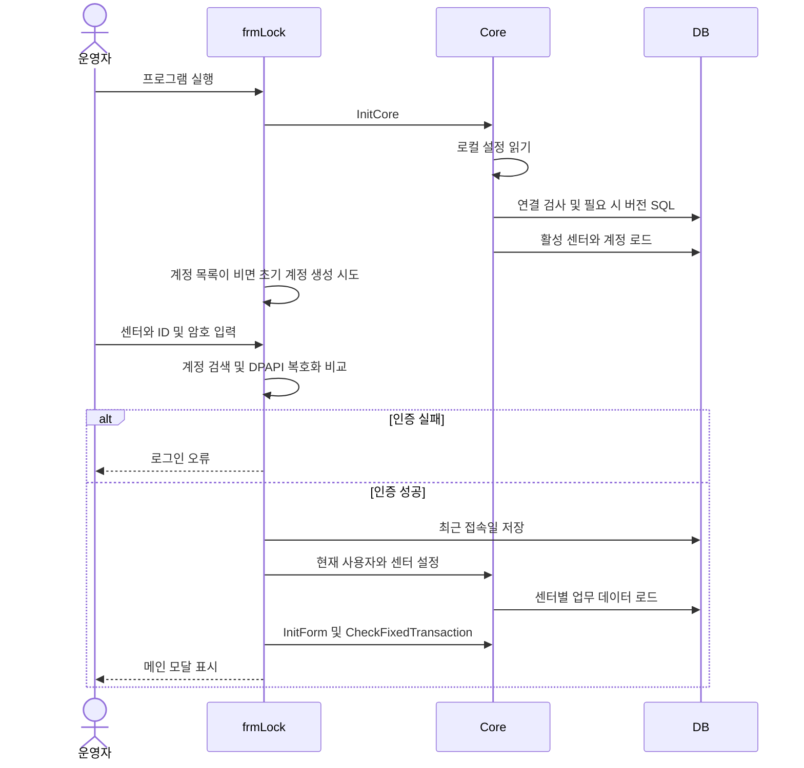
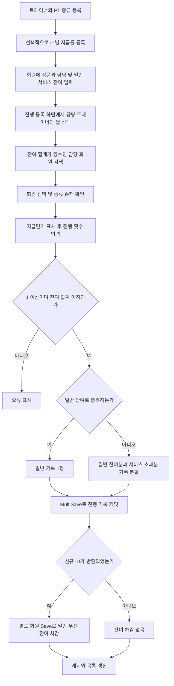
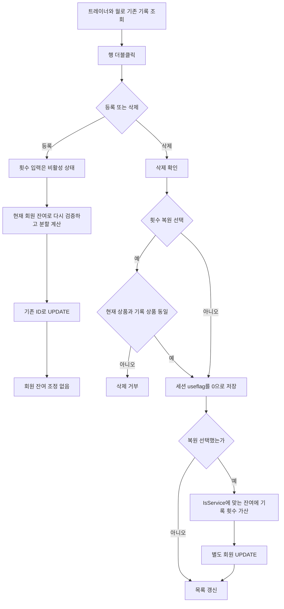
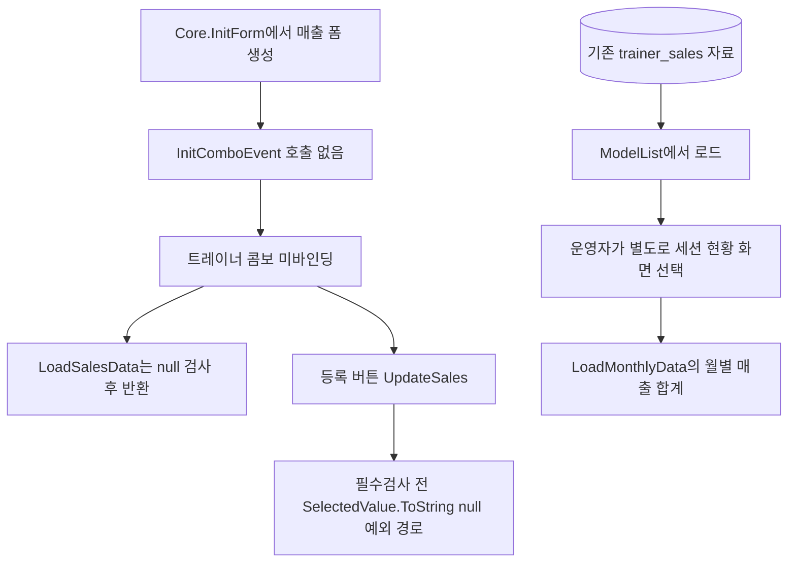
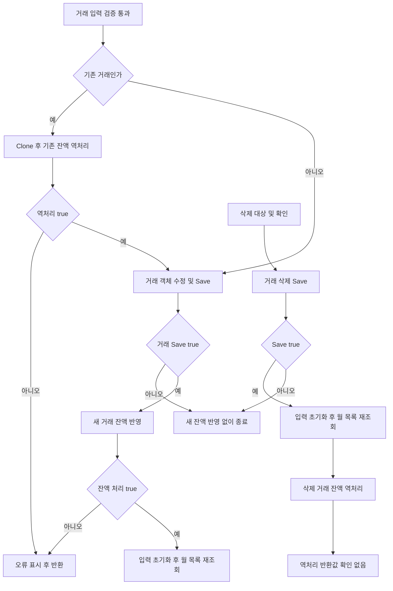
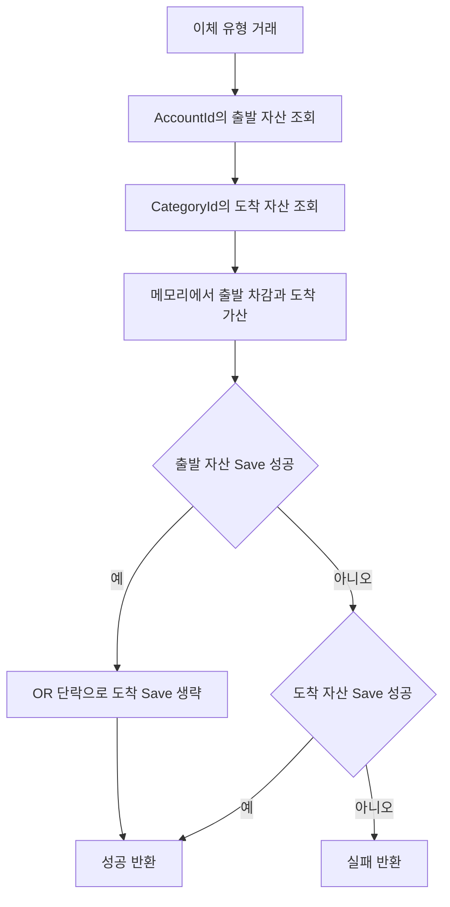
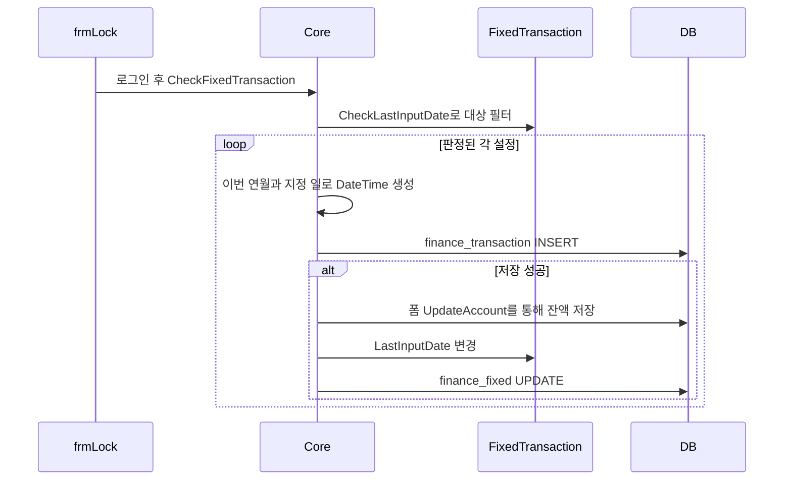
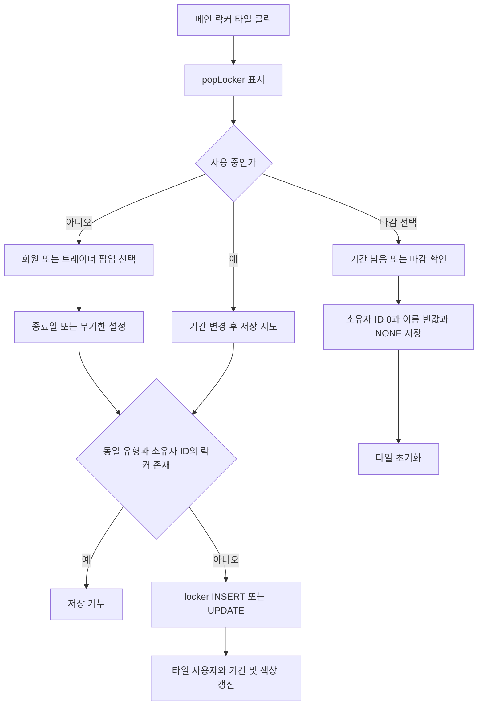
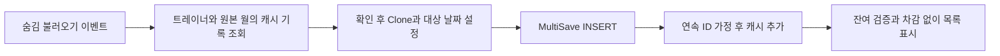

# 06. 주요 업무 흐름

아래는 현재 코드의 순서다. DB 호출이 분리된 곳은 다이어그램에서도 나누었다. 운영자가 어떤 순서로 상품·회원을 준비하는지는 **추정**이며, 호출 순서와 검증 분기는 코드로 확인했다. 계약→결제→예약 흐름은 구현 근거가 없어 만들지 않았다.

## B01. 시작·로그인·업무 화면 진입

근거: `Program.Main`, `frmLock.cs:21,44,89`, `Core.cs:68,80,105`, `ModelList.cs:970`. 버전 SQL은 읽기 전용이 아니다. 이 분석에서는 실행하지 않았다.

## B02. PT 이용정보 준비와 진행 횟수 등록

근거: `frmSettingUser.UpdateUser`, `frmSettingSession.UpdateSessionPrice/UpdateST`, `frmSessionRegister.UpdateSession:229`, `UserList.GetUsersHaveSessionDataTableByTrainerId:388/MinusUserSessionCount:397`. 준비 단계의 운영 순서는 **추정**이다. 기록 저장 실패 시 차감하지 않지만 차감 저장 실패는 기록을 취소하지 않는다. 혼합 시 일반 기록 금액 계산 결함은 K04 참조.

## B03. 진행 기록 수정·삭제·횟수 복원

근거: `frmSessionRegister.Grid_CellDoubleClick/UpdateSession/DeleteSession:180`. 삭제/복원은 환불 처리가 아니다. 회원이 이미 비활성화된 경우 null 접근 등은 보호되지 않은 경로다.

## B04. 트레이너 매출 화면의 막힌 경로와 기존 자료 집계

근거: Core.InitForm(80행), frmTrainerSales 생성자(28행)/InitComboEvent(52행)/LoadSalesData(114행)/UpdateSales(148행), frmSessionStats.LoadMonthlyData(123행). 저장 처리기는 있으나 표준 초기화에서는 정상 입력 흐름에 도달하지 못한다. 기존 DB 매출의 집계는 별도 경로다. 수업에서 매출 자동 생성이나 저장 후 통계 화면 자동 이동은 없다.

## B05. 가계부 거래 등록·수정·삭제

근거: frmFinanceInput.DeleteTransaction(241행), UpdateTransaction(263행), UpdateAccount(318행). 각 저장은 독립 호출이며 실패 시 이전 커밋을 되돌리지 않는다. true는 영향 행 수를 보장하지 않는다. 삭제는 목록 갱신 후 역처리한다. 카드 취소·환불 API 흐름이 아니다.

## B06. 이체 잔액 반영의 실제 경로

근거: `frmFinanceInput.UpdateAccount:318`. 이것은 의도된 정산 규칙이 아니라 현재 조건식의 결함이다. 역처리도 같은 저장 조건을 사용한다.

## B07. 로그인 시 고정 거래 자동 입력

근거: `Core.CheckFixedTransaction:167`, `ModelList.FixedTransactionList.GetListInput:853`, `FixedTransaction.CheckLastInputDate:73`. 지난달 누락분의 반복 보충은 없으며 판정식 자체에 월 반복 결함이 있다. 거래에 fixed ID를 남기지 않아 원본 추적은 메모에 의존한다.

## B08. 락커 배정·기간·마감

근거: `frmMain.Locker_ButtonClickEvent`, `popLocker.LoadOwner/SaveLocker/UseEnd`, `frmMain.SetLockerColor`. 만료는 표시만 바꾸며 자동 마감하지 않는다. 기존 소유자를 제외하지 않는 중복 검사 때문에 연장 시도는 거부될 수 있다.

## B09. 숨겨진 이전 월 복사

근거: `frmSessionRegister.LoadBeforeSession:129`, `frmSessionRegister.Designer.cs:285,297`. 버튼·날짜 입력이 Visible=false이고 다시 표시하는 코드는 찾지 못했다. 정상 사용자가 실행하는 현재 업무로 분류하지 않는다.

## 흐름 해석 보완

B01의 최근 접속일 저장은 시도이며 반환값을 확인하지 않는다. B03의 기존 ID UPDATE도 실제 변경을 보장하지 않는다(GymNo 누락, K05/K38). B07은 거래 Save가 true이면 UpdateAccount의 false를 검사하지 않고 LastInputDate를 변경하며 finance_fixed Save의 반환값도 무시한다(예외가 발생하지 않은 경로 기준). B08은 저장 성공 분기의 표현이며 마감 후 팝업 내부 선택 ID가 남는 별도 문제가 있다(K40).
