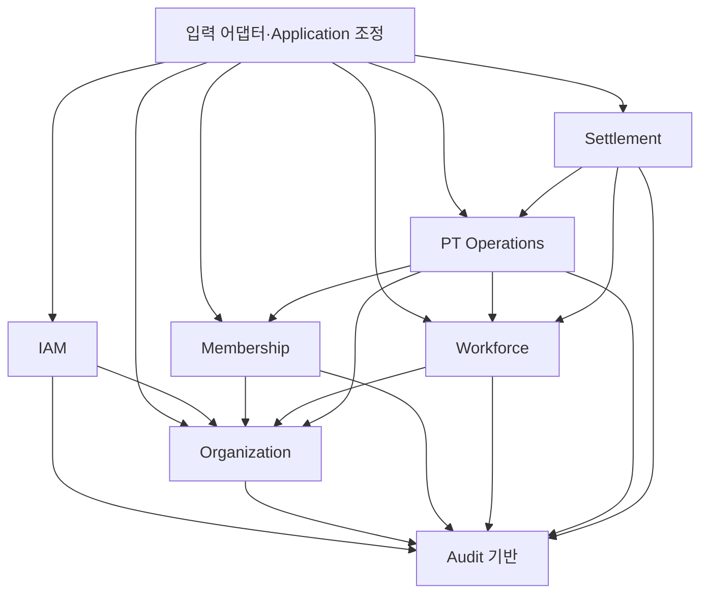

# 업무 모듈·소유권·추출 초안

Status: PROPOSED
작성일: 2026-09-17
승인된 시스템 형태는 [ADR-0002](../decisions/0002-modular-monolith.md)다. 아래 6개 모듈과 감사 기반 배치는 검토안이며 Product 정책 또는 구현 승인으로 간주하지 않는다. 이름은 논리적 식별자이며 패키지/폴더 구조를 확정하지 않는다.

## 분할 기준과 대안

FOUNDATION-001은 main/application/database/config 기반 코드만 구성한다. 아래 업무 모듈을 빈 패키지로 선행 생성하거나 일괄 승인하지 않는다. 실제 import 검사 범위는 [기반 검증 기록](foundation-001.md)과 구별한다. PT Session 등록은 기존 회원의 실제 수업 완료 기록이며 사전 예약 생성/존재를 요구하지 않는다(PR-008).

테이블별 모듈 대신 함께 바뀌는 업무와 원자적 변경을 묶었다. 특히 Product·Pass·Session·확정 Payment를 PT 운영에 함께 두어 Pass 선택 기준과 차감·지급의 분산 처리를 피한다. Trainer 소속과 보상 설정은 Home Branch 기반 인가가 함께 필요해 한 모듈로 제안한다. Additional Performance도 Trainer 보상 업무에 포함하되 독립 하위 책임으로 구분하고 미정 권한을 보상 설정에서 상속하지 않는다.

Product Catalog 분리, 보상 설정/추가실적 별도 모듈, PT와 정산의 통합도 가능하지만 지금은 전자는 계약/트랜잭션 수를 늘리고 후자는 설정·지급 원본과 월 결과의 책임을 흐리게 하므로 채택하지 않은 초안이다. 실제 변경 빈도와 OPEN 해소 후 재검토한다.

## 업무 개념별 단일 쓰기 소유권

| 개념 | 제안 소유자 | 다른 모듈의 이용 경로 |
| --- | --- | --- |
| 로그인 계정·역할·계정에 부여한 관리 Branch Scope·계정/Trainer 연결 | IAM(계정·권한) | 검증된 Actor 및 현재 권한 사실 계약 |
| Organization·Branch 기준정보/수명 | Organization(조직·지점) | Branch 존재/상태/조직 사실 계약 |
| Member 기본정보·Home Branch·변경 이력 | Membership(회원) | 허용 업무용 최소 Member 사실 계약 |
| Trainer 기본정보·Home Branch·변경 이력 | Workforce(트레이너·보상) | Trainer 사실 계약 |
| Rate·Fixed Amount·Base Salary 및 설정 변경 근거 | Workforce | 관리자 설정 기능과 제한된 내부 계산용 계약 분리 |
| Additional Performance 및 정정/취소 이력 | Workforce | 유효 실적의 정산 입력 계약; 상세 정책 결정 후 |
| Organization 공통 Product | PT Operations(PT 운영) | 공통 Catalog 기능 |
| Pass·Issued Branch·잔여·수동 조정 사유/이력 | PT Operations | Pass 업무 기능 |
| Session·Performed Branch·취소/정정 이력 | PT Operations | 등록/정정·허용 조회 및 최소 관련 수업 사실 계약 |
| 확정 Session Payment·계산 근거·유효 결과 | PT Operations | Settlement용 유효 지급 결과 계약 |
| 월 정산 결과·적용 기본급·구성별 합계/참조 근거 | Settlement(월 정산) | 허용 월 정산 결과 조회; 확정/정정 흐름은 OPEN |
| 중요 변경 감사 기록 | Audit 기반 | 업무 소유 모듈이 감사 기록 계약 호출; 보호된 조회 경로 |

한 소유자는 쓰기 책임을 뜻하며 한 테이블을 뜻하지 않는다. Settlement가 보존하는 적용 기본급/지급 합계는 특정 월 결과의 사실이지 Workforce 설정 또는 PT 지급 원본의 두 번째 수정 경로가 아니다. 감사는 원본 업무 상태를 바꾸지 않는다. Home Branch·Issued Branch·Performed Branch·비용 귀속은 별개다.

## 모듈별 책임과 계약

공개 기능은 내부 Application 계약의 개념이다. ID·명시적 값·불변 DTO·업무 결과를 전달하고 SQLAlchemy Session/ORM 객체를 기본 입출력으로 노출하지 않는다. 계약의 최종 서명과 예외 표현은 후속이다.

| 모듈 | 책임·소유 데이터 | 책임지지 않는 업무 | 외부에 제공할 기능 | 직접 소비하는 계약 | Product 추적 | OPEN 영향 | 추출 장애 |
| --- | --- | --- | --- | --- | --- | --- | --- |
| IAM | 로그인 계정 수명, 역할/관리 Scope, 검증된 Actor 문맥 | Trainer 소속의 원본, 보상 대상 인가의 최종 판단, 회원 로그인 v1 도입 | Actor/현재 권한 확인, 허용 계정 관리 | Organization Branch 사실, Audit 기록 | PR-001/021/026/029/030; PD-019; NFR-001 | ARCH-001/002, MB-004: 인증/수명·위임 | 권한 변경의 즉시성·업무 트랜잭션과 경쟁, 인증 장애 전파 |
| Organization | Organization와 Branch 기준정보, 지점 수명 | Trainer/Member 소속 변경, 계정 Scope 부여, 정산 비용 귀속 | Branch 관리, 최소 Branch 사실 조회 | Audit 기록 | PR-020; BR-OPS-001 | MB-004/008: 수정 범위·비활성 영향 | 모든 업무의 지점 사실 의존, 비활성 시 일관성 |
| Membership | Member와 단일 Home Branch, 비활성/변경 이력 | 로그인 계정, Pass 잔여, 타 지점 전체 회원 공개 | 허용 회원 관리/검색, 업무 대상 Member 사실 | Organization, Audit | PR-002/004/030; BR-OPS-001 | MB-002/005, LEGAL-001: 교차 조건·이동·필드 | PT 인가와 소속 이동의 공유 일관성 |
| Workforce | Trainer/Home Branch, 세 보상 설정, 추가실적 및 이력 | Product 방식, Session Payment 원본 계산/수정, 월 확정 결과 | Trainer 관리/사실, 보상 설정 조회/변경, 내부 Rate/Fixed Amount 입력 제공, 월 기본급/유효 추가실적 입력 제공, 추가실적 명령(게이트 후) | Organization, Audit; 관련 Member/Session 확인은 아래 조정 경로 | PR-005/007/027/031; BR-PAY-002/010/011/014/015 | MB-001/009/010, BR-010/012/013: 이동·금액·추가실적 권한/상태 | 설정 저장/Session 등록 순서, 민감값 전송, 연계 실적 정정 |
| PT Operations | Product·Pass·횟수·Session·확정 Payment와 정정/취소 이력 | Trainer 설정 원본 변경, 추가실적 인정, 월 기본급·월 마감 | Catalog/Pass 관리, 일반 Session 등록, 허용 정정/취소, 관련 수업 사실, 유효 지급 결과 제공 | Organization, Membership, Workforce, Audit | PR-003/006/008/009/027; BR-PAY-001–013 | BR-001/002/007/008/010/011, ARCH-003, MB-001/002/003/005/007/009 | 가장 강한 원자성 묶음. 보상·권한·소속 일관성까지 해소 필요 |
| Settlement | Trainer·월 정산 결과와 적용 구성의 보존/조회 | 현재 설정 변경, 원본 Session 지급 재계산, 추가실적 승인 | 월 입력 대사·집계, 허용 결과 조회, 결과 확정/정정 기능(게이트 후) | PT Operations, Workforce, Audit | PR-010; BR-PAY-009/014/016 | BR-007/008/009/012/013, MB-006/009/010 | 원본 정정과 마감 경쟁, 월 입력의 완전성/같은 기준시점, 지점별 공개 |

## 의존성 방향과 조정 경로

화살표는 공개 계약을 소비하는 방향이다. 업무 데이터 쓰기나 HTTP 호출 방향을 뜻하지 않는다. 각 모듈은 자신의 내부 구현만 접근한다.

- 입력 어댑터는 인증 결과를 신뢰 가능한 Actor 문맥으로 바꾸고 Application 조정이 IAM의 현재 권한 확인을 수행한다. 업무 소유 모듈도 대상/행위 인가를 검사한다. 조직/회원 등에서 IAM을 역호출하는 코드 순환 대신 검증된 권한 사실을 전달한다. 클라이언트가 보낸 Role/Branch 값을 신뢰하지 않는다.
- 추가실적이 Member/Session을 참조할 때는 Application 조정이 Membership/PT의 최소 사실을 조회해 Workforce 명령에 검증 근거로 전달한다. Workforce가 PT를 직접 import하여 PT→Workforce와 순환하지 않는다. 검증 근거는 임의 클라이언트 payload가 아니며, 동일 업무 트랜잭션 안에서 유효성을 보장해야 한다. 실제 허용 관계·취소 연동은 BR-013/MB-009 결정 전 확정하지 않는다.
- 원본 정정과 정산의 공동 변경이 승인될 경우에도 상위 조정이 각 소유 모듈 계약을 호출한다. PT가 Settlement 내부를 역호출하거나 대신 수정하지 않는다. 어떤 변경을 함께 반영할지는 BR-007/009/013 게이트다.
- 상위 조정은 Use Case의 순서/트랜잭션을 조정한다. 금액 계산·추가실적 승인·정산 귀속 등의 업무 규칙을 공통 조정 파일로 옮기지 않는다.
- 공통 기반에는 Actor 문맥, 최소 식별/값 계약, 트랜잭션 수명 추상화, 감사 기록 같은 기술 공통 요소만 검토한다. 모든 ORM/Repository/업무 정책을 common으로 모으지 않는다.

## 감사 배치

Audit을 독립 서비스나 별도 보상 업무 모듈 대신 제한된 공통 기반 기능으로 제안한다. 변경 원본과 함께 실패해야 하고 모든 모듈에 일관된 기록이 필요하기 때문이다. 기록의 단일 쓰기 소유자는 Audit이며 대상·행위·필요 변경값의 업무적 의미는 발생 모듈이 구성한다.

감사 조회는 업무 소유 모듈의 인가된 Application 경로에서 허용 대상/항목을 확정하고 Audit의 제한된 읽기 계약으로 조회한다. Audit이 모든 모듈 정책을 역호출하는 의존성을 만들지 않는다. 무제한 raw audit 조회를 외부에 공개하지 않는다. 보상 전후 값은 보호된 감사에 필요하지만 일반 로그·오류·분석 지표로 복사하지 않는다. 최소 보존 정보와 조회 예외·기간은 PR-027, ARCH-001, LEGAL-001을 따른다.

## 향후 선택적 서비스 추출

현재 동기 내부 계약 호출과 하나의 PostgreSQL 업무 트랜잭션을 제안한다. 다음은 미래 검토 후보이며 서비스화 일정/메시징 선택이 아니다.

| 후보·이유 | 함께 이동해야 할 데이터 | 소비 계약 | 현재 결합·추출 선행 조건 |
| --- | --- | --- | --- |
| Settlement: 독립 집계 부하/배포 수요가 생길 경우 | 정산 결과·적용 구성/근거·정정 이력·관련 감사 책임 | PT 유효 지급, Workforce 기본급/실적, 허용 결과 조회 | 완전한 월 입력/정정 반영과 마감 정책 확정. 현재 동기 일관 조회를 분리 시 재설계 |
| Workforce: 인력/보상 정책 수명에 독립 수요가 생길 경우 | Trainer 소속, 설정·이력, 추가실적·정정 이력·감사 | PT의 적용 지급 입력, Settlement의 월 입력 | 설정 저장 완료와 신규 Session 적용 순서를 네트워크 장애 중에도 보장할 방안 필요. PT와 함께 유지/추출할 가능성도 검토 |
| PT Operations: PT 부하/독립 소유팀 수요가 생길 경우 | Product·Pass·횟수 이력·Session·Payment·취소/정정·중복처리 결과·감사 | Session 명령, 유효 지급/수업 사실 | Pass/Session/Payment를 한 강한 일관성 묶음으로 이동. IAM/Member/Trainer 상태 의존 해소 전 단독 추출 보류 |
| IAM/Membership/Organization | 해당 소유 데이터와 이력, 관계 식별 연속성 | Actor/대상/지점 사실 | 매 요청의 현재 권한/소속 확인 지연·장애 및 개인정보 복제 관리 비용. 지금 우선 추출 근거 없음 |

동기 호출은 즉시 결정이 필요한 조회/명령 후보이나 timeout과 결과 불명확 상태를 처리해야 한다. 비동기 전달은 정책상 지연이 허용된 읽기용 집계/알림 후보일 뿐 현재 확정안이 아니다. 필수 지급 결과/감사를 나중에 알림으로 저장하는 방식은 일반 Session 원자성의 대체가 아니다.

추출 시 각 후보마다 다음을 검증한다.

1. 소비자·계약 버전·업무 의미·민감 필드를 목록화하고 이전 계약과 새 계약의 병행 호환 기간을 정한다.
2. 쓰기 소유자를 한쪽으로 유지한 채 데이터 이전 기준시점, 증분 반영, 건수/잔여/금액/감사 참조 대사를 계획한다. 이는 미래 웹 서비스 내부 이전이며 기존 C# 데이터 이관 요구를 부활시키지 않는다.
3. 순서 변경·중복·재시도·통신 실패에서 재처리 가능한 전달과 결과 확인을 설계한다. Outbox는 DB 변경과 전달 의도 기록의 불일치를 줄이는 검토 후보이며 전달 완료/정확히 한 번 처리를 자동 보장한다고 가정하지 않는다.
4. 읽기 shadow 비교와 점진적 경로 전환을 검토하되 무통제 이중 쓰기는 피한다. 공유 트랜잭션·FK·직접 조회 예외를 하나씩 대체하고 장애 복구·대사를 통과한 뒤 경계를 옮긴다.
5. 금액/잔여 불일치, 권한 노출, 지속 누락·지연, 운영 목표 미달을 되돌림 조건으로 둔다. 전환 후 새로 생긴 쓰기의 역동기화/대사 없이 라우팅만 이전 시스템으로 돌리지 않는다. 소유권 복귀와 데이터 복구 경로가 없으면 전환을 보류한다.

서비스 추출은 내부 함수를 HTTP로 바꾸는 작업만으로 끝나지 않는다. 관련 [검증 계획](validation-plan.md)과 별도 추출 ADR이 필요하다.
