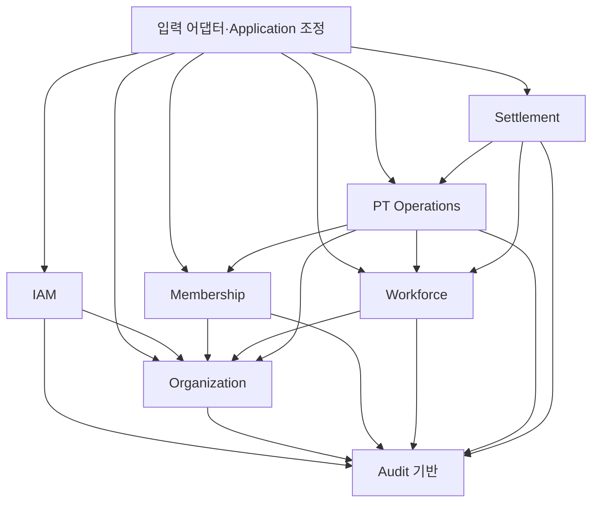

# 업무 모듈·소유권·추출 초안

2026-10-12 승인 정책 반영 경계: [2026-10-12 일괄 승인](../product/product-decisions.md#review-20261012-batch)과 ADR-0004 v1 인증 방식 ACCEPTED를 입력으로 사용한다. B/A 정책 승인으로 이 문서의 모듈 소유권·공개 계약·DB 직접 접근 예외·Caller/저장/UoW/잠금이 채택되는 것은 아니다. 직접 다른 모듈 DB 읽기 예외 **현재 승인 0건**을 유지한다. 새 Pass 활성 담당 필수/상품 최초 횟수·관리자 초과 잔여 추가, Branch 비활성 신규 업무 차단, 공통 Asia/Seoul 및 로그인/역할 철회 정책을 이후 계약/원자성/경합 검증에 반영해야 한다. 실제 구현/DB 검증은 이번에 수행하지 않았다.

Status: PROPOSED
작성일: 2026-09-17
승인된 시스템 형태는 [ADR-0002](../decisions/0002-modular-monolith.md)다. 아래 6개 모듈과 감사 기반 배치는 검토안이며 Product 정책 또는 구현 승인으로 간주하지 않는다. 이름은 논리적 식별자이며 패키지/폴더 구조를 확정하지 않는다.

## 분할 기준과 대안

FOUNDATION-001은 main/application/database/config 기반 코드만 구성한다. 아래 업무 모듈을 빈 패키지로 선행 생성하거나 일괄 승인하지 않는다. 실제 import 검사 범위는 [기반 검증 기록](foundation-001.md)과 구별한다. PT Session 등록은 기존 회원의 실제 수업 완료 기록이며 사전 예약 생성/존재를 요구하지 않는다(PR-008).

테이블별 모듈 대신 함께 바뀌는 업무와 원자적 변경을 묶었다. 특히 Product·Pass·Session·일반 Session Payment를 PT 운영에 함께 두어 일반 지급 대상의 Pass 선택·차감·지급 분산 처리를 피한다. 타 지점 지원 수업은 진행 기록·차감을 먼저 완료하고 이후 관리자 금액 저장 시 Additional Performance 보상을 확정하는 별도 흐름이다. Trainer 소속과 보상 설정은 Home Branch 기반 인가가 함께 필요해 한 모듈로 제안한다. Additional Performance도 Trainer 보상 업무에 포함하되 독립 하위 책임으로 구분하고 미정 권한을 보상 설정에서 상속하지 않는다.

Product Catalog 분리, 보상 설정/추가실적 별도 모듈, PT와 정산의 통합도 가능하지만 지금은 전자는 계약/트랜잭션 수를 늘리고 후자는 설정·지급 원본과 월 결과의 책임을 흐리게 하므로 채택하지 않은 초안이다. 실제 변경 빈도와 OPEN 해소 후 재검토한다.

Operator 발급 제안(2026-10-12 Product 확정 BR-OPS-011·PR-021): IAM은 새 계정/Operator 역할/최초 단일 업무 Branch 및 현재 발급 Caller를 책임지는 안이며 Organization의 실제 대상 Branch/Organization 사실·Audit 공개 계약을 조합한다. 발급 Actor는 Master Organization 전체/Branch Admin 자기 단일 Branch로 승인됐고 기존 최초 비밀번호 설정 링크 방식을 재사용한다. 다른 역할/기존 계정 변경 위임은 승인하지 않았으며 계약·소유권/저장·UoW는 PROPOSED다. 업무 모듈의 쿠키 직접 해석/타 모듈 Repository·ORM 수정/직접 DB 읽기 예외와 IAM-001 S1 Operator 구현을 추가하지 않는다.

## 업무 개념별 단일 쓰기 소유권

| 개념 | 제안 소유자 | 다른 모듈의 이용 경로 |
| --- | --- | --- |
| 로그인 계정·역할·계정에 부여한 관리 Branch Scope·계정/Trainer 연결 | IAM(계정·권한) | 검증된 Actor 및 현재 권한 사실 계약. Operator 업무 Scope는 단일 Branch로 Product 확정(2026-10-12, BR-OPS-011); 기존 겸임의 독립 Scope·Trainer Home Branch는 별개. 새 Operator 생성/최초 Branch 지정 Actor는 Master Organization 전체/Branch Admin 자기 단일 Branch로 확정(2026-10-12); 기존 Operator 지점 변경은 Master Organization 전용으로 확정; 발급 절차·기존 계정 역할 변경·Operator 변경 대상/절차·나머지 계정 업무 위임은 게이트 유지, 역할/Scope 저장·Caller 계약은 PROPOSED |
| Organization·Branch 기준정보/수명 | Organization(조직·지점) | Branch 존재/상태/조직 사실 계약 |
| Member 기본정보·Home Branch·활성 상태/변경 이력 | Membership(회원) | 허용 업무용 최소 현재/실제 수업 시점 Member 사실 계약. J1–J3의 기본정보 관리 인가·Member 비활성 새 Pass/해당 기간 수업 차단·잔여/이력 보존은 Product 확정이며 구체 소유권/계약은 PROPOSED |
| Trainer 기본정보·Home Branch·변경 이력 | Workforce(트레이너·보상) | Trainer 사실 계약; 실제 수업 당시 Home Branch 확인을 포함하는 계약을 후속 설계(PROPOSED). 일반/지원 구분의 수행 시점 기준은 Product 확정(2026-10-11) |
| Rate·Fixed Amount·Base Salary 및 설정 변경 근거 | Workforce | 관리자 설정 기능과 제한된 내부 계산용 계약 분리. 지원→일반 오류 정정의 최초 PT 기록 생성 시점 Rate/Fixed Amount 적용은 Product 확정(2026-10-11). 최초 일반 지급이 없던 기록도 그 시점 설정을 확인할 수 있는 제한된 계약/이력·저장 방식을 후속 설계(PROPOSED). Base Salary 변경의 적용 시작 월은 관리자가 미확정인 과거 월을 포함해 지정하고 적용되는 수동 지정 없는 기존 미확정 정산의 기본급/합계는 자동 반영(Product 확정). Workforce 설정과 Settlement 월 결과의 소유권은 유지. 월 설정/이력 저장 구조·자동 반영 및 정산 입력 계약은 후속; 이동월 기본급 비용의 대상 월말 Home Branch 전액 귀속은 Product 확정(2026-10-11). 월말 소속 사실/이력과 해당 월 적용액을 조합하는 계약은 후속 설계 |
| Additional Performance 및 정정/취소 이력 | Workforce | 유효 실적의 정산 입력 계약; 지원 수업은 실제 Performed Branch, 지원 수업 외 추가실적은 발생 당시 Trainer Home Branch 비용 귀속으로 Product 확정(2026-10-11). 발생/당시 소속 사실·수업 연계의 제한된 계약과 비용 보고 공개/집계 상세는 후속 |
| Organization 공통 Product | PT Operations(PT 운영) | 공통 Catalog 기능. 생성/수정은 Master 전용/현재 Organization Scope 검증(Product 확정, 2026-10-12; MB-007 CLOSED). 판매 중단은 새 Pass 발급만 차단/기존 Pass 조건부 사용 유지(Product 확정, 2026-10-12; BR-PAY-001). 구체 계약/저장은 PROPOSED |
| Pass·담당 Trainer/교체 이력·발급 당시 상품 가격/총횟수/Payment Type·Issued Branch·잔여·수동 조정 사유/이력 | PT Operations | Pass 업무 기능. Member Home Branch 밖 같은 Organization 지점의 새 Pass 발급·기존 Member/소속 유지·실제 Issued Branch 기록은 Product 확정(2026-10-12, BR-OPS-010). IAM 발급 Caller/허용 Branch·Organization의 최소 Branch 사실·Membership의 최소 Member 사실과 공통 상품/감사 계약을 조합하는 소유권/공개 계약·저장/UoW는 후속(PROPOSED); 새 Pass 발급은 Master Organization 전체/Branch Admin 자신의 단일 관리 Branch/Operator 부여된 허용 발급 Branch Scope에서 허용·Trainer 단독 불가로 Product 확정(2026-10-12, BR-OPS-010); 겸임은 독립 발급 역할/Scope로 판단하며 Operator의 관리자 전용 업무 권한은 늘리지 않음. 발급용 이름·전화번호 일부의 같은 Organization 전체 지점 Member 검색과 결과 이름·전체 전화번호·현재 Member Home Branch 공개는 Product 확정(2026-10-12, BR-OPS-010). 현재 발급 Caller/실제 Issued Branch를 검증해 Membership 공개 검색 계약으로 필요한 Member 후보를 식별하는 안은 PROPOSED이며 일반 Trainer/Member 상세 조회와 분리한다. 새 Operator 발급 절차·기존 계정 역할 부여·Master 전용 Operator 지점 변경의 대상/절차·추가 공개 정보·Member 선택용 최소 식별 응답/계약/활성/초기 조건은 게이트 유지. IAM은 현재 Caller의 발급 역할/Scope를 제공하고 업무 모듈은 쿠키/클라이언트 역할 값 대신 검증된 Caller를 사용하는 안이며 계약/저장/UoW는 계속 PROPOSED. 수동 조정의 Master Organization 전체/Branch Admin 현재 관리 Branch=Issued Branch·사유/이력/감사·범위 내 직접 처리는 Product 확정(2026-10-12, BR-OPS-009). PT Operations Pass/조정 이력·IAM 현재 Caller·Audit 계약/저장/UoW와 수량/상태 조건은 후속(PROPOSED). 수업 취소 자동 복원의 기존 업무 권한/조건은 별도 유지. 기존 Pass 담당 교체 허용/잔여·과거 기록/발급 조건 유지는 Product 확정(2026-10-12, BR-OPS-008), 교체 권한은 Master Organization 전체/Branch Admin 처리 시점 Member 현재 Home Branch로 Product 확정(2026-10-12); 대상은 같은 Organization의 다른 지점 Trainer도 허용으로 Product 확정(2026-10-12). IAM Caller 관리 Scope·Membership 최소 현재 소속/Pass Member 관계·Workforce 최소 Trainer Organization 사실 검증과 선택 정보/이력·감사 공개 계약/저장 및 대상 활성/잔여 소진 외 Pass 상태 상세는 후속(PROPOSED). 잔여를 모두 사용한 0 Pass도 담당 교체·새 현재 담당 Member 조회 허용으로 Product 확정(2026-10-12, BR-OPS-008); 잔여/상태·과거 기록 보존·정상 차감 불가·기존 현재 관계 인가와 선택 필터 유지, 저장 상태명/조회·교체 계약은 후속(PROPOSED). 교체 전 실제 본인 수업은 이전 담당 직접 누락 등록 허용/회원 조회 권한 비복원으로 Product 확정(2026-10-12, BR-OPS-003/008); PT Operations의 과거 담당 이력·Membership 대상 Member 사실·IAM 현재 Caller 및 Workforce 실제 수행 Trainer의 최소 사실을 조합할 계약/최소 식별·응답/UoW·경합은 후속(PROPOSED). 보상 설정 조회 권한이나 내부 Repository/ORM 수정 예외를 부여하지 않음. 만료일/자동 만료 없음·관리자 수동 만료/같은 Pass의 만료 해제 및 잔여 보존은 Product 확정(2026-10-12; BR-OPS-004); 상태/이력/인가 계약과 저장은 후속 설계(PROPOSED) |
| Session·Performed Branch·취소/정정 이력 | PT Operations | 등록/정정·허용 조회 및 최소 관련 수업 사실 계약 |
| 확정 Session Payment·계산 근거·유효 결과 | PT Operations | Settlement용 유효 지급 결과 계약; 일반 지급 비용은 해당 수업의 실제 Performed Branch에 확정액 합산으로 Product 확정(2026-10-11). 유효 지급/수행 지점 사실을 제공하는 제한된 조회 계약과 비용 보고 공개/집계 상세는 후속 |
| 월 정산 결과·적용 기본급·구성별 합계/참조 근거 | Settlement(월 정산) | 허용 월 정산 결과 조회; 미확정 월 기본급 수동 지정/수정은 Master Organization 전체/Branch Admin 처리 시점 Trainer 현재 Home Branch 기준 인가·본인 포함·별도 Master 승인 없음(Product 확정), 구체 공개 계약은 후속; 기본급 오류의 해당 월 확정 해제/기본급 정정/재확정과 이전 확정본 보존 및 Master Organization/Branch Admin 처리 시점 Trainer 현재 Home Branch 기준 인가·별도 Master 승인 없음·확정 해제/해당 월 기본급 수정 사유 필수·오류 정정의 해당 월 한정 및 현재/미래 설정·다른 월 유지까지 확정(미래 적용 월의 입력 범위 등 BR-012 OPEN); 지원 수업 금액 오류의 해당 월 확정 해제/정정/재확정과 이전 확정본 보존·지원 수업 정정 시 Master Organization/Branch Admin 대상 Trainer Home Branch 기준 해제·재확정 권한·해당 Branch Admin 정정의 별도 Master 승인 없음·지원 수업 정정의 확정 해제 사유 필수 기록·지원 수업 정정의 처리 시점 현재 Home Branch 인가 기준은 확정, 남은 흐름은 OPEN; 최초 확정 역할/Scope는 Master Organization 전체/Branch Admin 처리 시점 Trainer 현재 Home Branch·본인 포함·별도 Master 승인 없음으로 Product 확정(2026-10-11), 상세 공개·귀속·나머지 확정 조건은 OPEN; 조회 시점 현재 Home Branch가 관리 Branch인 Trainer의 해당 월 전체 금액·구성 내역 공개(타 지점 지원 보상 포함)는 Product 확정(2026-10-11), 남은 조회 상세/비용 귀속은 OPEN; v1 지점별 비용 보고서 Master Organization 범위 전용 조회는 Product 확정(2026-10-11), Branch Admin의 자기 소속 Trainer 월 정산 전체 조회와 구분. 구체 보고 계약/저장/집계/버전은 PROPOSED |
| 중요 변경 감사 기록 | Audit 기반 | 업무 소유 모듈이 감사 기록 계약 호출; 보호된 조회 경로 |

한 소유자는 쓰기 책임을 뜻하며 한 테이블을 뜻하지 않는다. Settlement가 보존하는 적용 기본급/지급 합계는 특정 월 결과의 사실이지 Workforce 설정 또는 PT 지급 원본의 두 번째 수정 경로가 아니다. 감사는 원본 업무 상태를 바꾸지 않는다. Home Branch·Issued Branch·Performed Branch·비용 귀속은 별개다.

Operator 업무 Branch 변경(2026-10-12 Product 확정, BR-OPS-011)은 IAM의 관리 Scope 변경 책임으로 설계한다(PROPOSED). 현재 Master Caller/Organization·기존 대상 계정/Operator Scope와 Organization의 실제 전후 Branch 사실·Audit 계약을 조합한다. Branch Admin의 신규 발급 권한으로 기존 Branch를 덮어쓰지 않으며 Member/Trainer Home Branch·PT Operations의 기존 Pass/이력은 변경하지 않는다. 기존 저장 후 후속 요청의 현재 Scope/실패 보존·감사 조건을 만족하는 공개 계약·저장/UoW/캐시는 후속이며 모듈 소유권/경계·S1 구현을 승인하거나 직접 DB 접근 예외를 추가하지 않는다.

신규 Trainer 계정 발급(2026-10-12 Product 확정, BR-OPS-012): Actor는 Master Organization 전체/Branch Admin 대상 Trainer 현재 Home Branch 범위다. IAM 계정/역할/실제 Trainer 연결과 Workforce의 Trainer/현재 Home Branch·Organization 사실 및 Organization/Audit 공개 계약을 상위 Application에서 조정하는 안은 PROPOSED다. Workforce Home Branch 원본을 IAM 관리/Operator Scope로 복제·대체하지 않는다. 허용 발급 Actor에게 기존 계정 역할/연결 덮어쓰기·관리자 승격·Trainer 이동/수명 업무 권한을 자동 부여하지 않으며 최초 비밀번호 설정 링크를 재사용한다. 최소 Trainer 선택/연결/기존 연결 충돌·계정 활성화/저장/UoW·동시성은 후속이고 타 모듈 Repository/ORM/DB 직접 접근 예외를 추가하지 않는다.

Trainer Home Branch 변경(2026-10-12 Product 확정, BR-OPS-013): Master Organization 범위 전용이다. Workforce의 Trainer 현재 Home Branch/소속 이력 변경을 IAM 현재 Master Caller·Organization 최소 Branch 사실·Audit 계약으로 조정하는 안은 PROPOSED다. IAM 관리/Operator Scope·계정/Trainer 연결을 함께 자동 변경하지 않는다. 기존 저장 후 현재 Home Branch 인가/실패 보존·감사와 수업 당시 소속 사실·기존 담당/지원 관계/보상 보존 조건을 만족할 공개 계약·저장/UoW·캐시·동시 이동/인가 경합은 상세 설계/검증 대상이다. 과거 소속 이력 정정·당시 사실 확인 불가 정책이나 타 모듈 Repository/ORM/DB 접근 예외를 확정하지 않는다.

## 모듈별 책임과 계약

공개 기능은 내부 Application 계약의 개념이다. ID·명시적 값·불변 DTO·업무 결과를 전달하고 SQLAlchemy Session/ORM 객체를 기본 입출력으로 노출하지 않는다. 계약의 최종 서명과 예외 표현은 후속이다.

| 모듈 | 책임·소유 데이터 | 책임지지 않는 업무 | 외부에 제공할 기능 | 직접 소비하는 계약 | Product 추적 | OPEN 영향 | 추출 장애 |
| --- | --- | --- | --- | --- | --- | --- | --- |
| IAM | 로그인 계정 수명, 역할/관리 Scope, 검증된 Actor 문맥 | Trainer 소속의 원본, 보상 대상 인가의 최종 판단, 회원 로그인 v1 도입 | Actor/현재 권한 확인, 허용 계정 관리 | Organization Branch 사실, Workforce 최소 Trainer/현재 Home Branch 사실, Audit 기록 | PR-001/021/026/029/030; PD-019; NFR-001 | ARCH-001/002, MB-004: 인증/수명·위임 | 권한 변경의 즉시성·업무 트랜잭션과 경쟁, 인증 장애 전파 |
| Organization | Organization와 Branch 기준정보, 지점 수명 | Trainer/Member 소속 변경, 계정 Scope 부여, 정산 비용 귀속 | Branch 관리, 최소 Branch 사실 조회 | Audit 기록 | PR-020; BR-OPS-001 | MB-004/008: 수정 범위·비활성 영향 | 모든 업무의 지점 사실 의존, 비활성 시 일관성 |
| Membership | Member와 단일 Home Branch, 비활성/변경 이력 | 로그인 계정, Pass 잔여, 타 지점 전체 회원 공개 | 허용 회원 관리/검색, 업무 대상 Member 사실. Member Home Branch 변경은 Master Organization 전체 또는 변경 전 Member 현재 Home Branch 관리 Branch Admin만/받는 지점 별도 승인 없음(Product 확정, 2026-10-12; BR-OPS-007). 저장 완료 즉시 적용만/미래 예약 미지원도 Product 확정(2026-10-12). 이동 대상은 같은 Organization의 활성 Branch만 허용/비활성 대상은 Master·Branch Admin 모두 Backend 거부(Product 확정, 2026-10-12). 대상 상태 원본은 Organization의 최소 공개 사실 계약으로 검증하는 안이 PROPOSED다. 성공 이후 후속 Home Branch 인가는 새 소속/실패 시 기존 소속 유지, 기존 지원 허용·Pass/과거 이력 보존 및 중요 변경 이력/감사 원칙 적용. Membership 변경 명령·IAM Caller/최소 Organization Branch 사실·Audit의 공개 계약/저장/UoW는 PROPOSED, 과거 소속 이력 정정·Branch 비활성화 자체의 영향/상태 표현·진행 중 요청/동시 이동·상태 변경 일관성은 후속. 새 회원 전화번호 필수/누락·빈값·공백만으로 등록 완료 불가는 Product 확정(2026-10-12; BR-OPS-006). 일반 수정의 필수 번호 비움 금지는 사용자 일관성 지시 적용. 같은 번호를 여러 Member가 사용하는 중복 허용/별도 Member 식별은 Product 확정(2026-10-12), 일반 수정에도 사용자 일관성 지시 적용. 번호로 Member/관계·권한을 합치지 않으며 검색은 인가된 회원만. Backend 필수 입력 검증·기존 업무 인가를 조합하는 공개 계약/저장/UoW는 후속(PROPOSED). Trainer 조회 대상은 본인 담당 Pass의 회원+개별 허용 지원 회원만(Product 확정, BR-OPS-005); 지원 지정/수동 해제는 Master Organization/Branch Admin 각 처리 시점 Member 현재 Home Branch 기준(해제는 기존 사용자 일관성 지시 적용); 개별 지원 허용은 관리자 해제 전 유지/기간 자동 종료 없음(Product 확정, 2026-10-12). 동일 Organization 내 Member Home Branch 변경 후 허용 유지/현재 Member Home Branch 관리 Scope 적용(Product 확정, 2026-10-12), Trainer Home Branch만 변경된 경우도 동일 원칙 적용(사용자 일관성 지시). 담당 Pass 잔여 모두 0이어도 담당 회원 조회 유지/기본 포함 및 선택 제외 필터 제공(Product 확정, 2026-10-12). 필터는 인가된 Member 전체 Pass 잔여(다른 담당 Trainer/Issued Branch 포함)이며 개별 지원 회원도 같은 기준(Product 확정, 2026-10-12). 인가된 담당/지원 회원의 전체 전화번호 읽기는 Product 확정(2026-10-12), 현재 Caller/Member 관계와 필드 공개 계약은 후속. 다른 종료 상태별 잔여 정의/집계·전화번호 외 필드/전화번호 형식·검증 정책은 게이트이며 Pass 잔여 소유권을 Membership으로 옮기지 않는다. 지원 허용 소유권/관계 사실·허용 대상 조합/이동·필터 조회 일관성 계약은 후속 | Organization, Audit | PR-002/004/030; BR-OPS-001 | MB-001/002/003/005, LEGAL-001: 담당 관계/지원 허용·교차 조건·이동·필드 | PT 인가와 소속 이동의 공유 일관성 |
| Workforce | Trainer/Home Branch, 세 보상 설정, 추가실적 및 이력 | Product 방식, Session Payment 원본 계산/수정, 월 확정 결과 | Trainer 관리/사실, 보상 설정 조회/변경, 내부 Rate/Fixed Amount 입력 제공, 월 기본급/유효 추가실적 입력 제공, 추가실적 등록 및 월 확정 전 지원 수업 금액 수정 계약(처리 시점 Trainer 현재 Home Branch 인가, 해당 모든 수정에 변경 사유 필수, 별도 승인 없이 저장 즉시 반영; 남은 상태/정정·계약 상세 후); 지원 수업 외 추가실적 금액도 관리자 건별 수동 입력(Product 확정, 2026-10-11), 기존 관리 Scope·본인 등록·승인 생략·감사 유지. 상한액/정밀도 등 나머지 입력 제약/정정·취소 등 남은 정책 후 구체 계약 설계(PROPOSED); v1은 기존 관리자 직접 등록만 지원하고 Trainer 별도 신청/승인·반려 계약은 도입하지 않음(Product 확정, 2026-10-11). Trainer PT 진행 기록 및 관리 권한 안 본인 직접 등록 유지; 지원 수업 외 최초 등록은 내용+금액 동시 입력 필수이며 미입력 등록 완료/자동 0원 대체·선등록 후금액 입력 없음(Product 확정, 2026-10-11). 지원 수업의 기존 두 단계는 유지. 등록 계약/저장/UoW는 후속 설계(PROPOSED); 지원 수업 외 등록 금액 > 0/0원·음수 거부는 Product 확정(2026-10-11). 지원 수업의 사유 필수 0원 허용 유지. 구체 입력/저장 검증 계약은 후속 설계(PROPOSED); 지원 수업 외 유효 실적은 실제 발생 월의 Trainer 정산 입력으로 제공/등록 월 이월 없음(Product 확정, 2026-10-11). 확정된 발생 월 누락 실적은 해당 Trainer/월 해제 후 등록·재확정 연계/이전 확정본 보존으로 Product 확정(2026-10-11). 등록 계약/정산 연계는 본인 건 포함·별도 승인 없음 정책을 반영해 구체화(PROPOSED) 지원 수업 외 실적 등록 및 확정 월 누락분 반영의 해제·재확정은 Master Organization 전체/Branch Admin 각 처리 시점 Trainer 현재 Home Branch 기준으로 인가(Product 확정, 2026-10-11). 단계마다 재검증하며 이전 소속/발생 당시 소속만으로 권한 없음. 발생 월 정산·발생 당시 Home Branch 비용 귀속은 유지. 이 후등록의 해제/재확정 본인 건 허용·별도 승인 없음은 확정(2026-10-11). 기존 실적 정정/취소는 별도 OPEN. 확정 월의 누락된 지원 수업 외 실적 반영을 위한 해제 사유 필수(Product 확정, 2026-10-11). 사유 없는 해제 요청은 거부하고 요청 직전 확정 상태/확정본/기존 실적·정산 구성/금액 유지. 성공 시 대상 Trainer/월·사유·해제자·시점 이력/감사와 이전 확정본 보존. 현재 Home Branch 인가·기존 후등록 순서/월/비용 귀속 유지. 이 흐름의 해제/재확정은 관리 범위 안 본인 건도 별도 승인 없이 허용(2026-10-11). Branch Admin의 본인이 아닌 소속 Trainer 누락 실적 후등록 해제/재확정은 별도 Master 승인 없음(Product 확정, 2026-10-11). 각 처리 시점 현재 Home Branch 인가·해제 사유 필수·해제 후 등록/동일 월 재확정·이전 확정본/감사·기존 확정 조건/미입력 지원 수업 차단 유지. 관리 범위 안 관리자 본인 건의 해제/재확정 허용·별도 승인 없음도 확정(2026-10-11). 관리 범위 안 관리자·Trainer 겸임자의 본인 누락 실적 후등록 해제/재확정도 별도 승인 없이 허용(Product 확정, 2026-10-11). Master Organization 범위/Branch Admin 각 처리 시점 본인 현재 Home Branch 일치·해제 사유 필수·본인 감사/이전 확정본 보존·기존 후등록 순서/월/비용 귀속·재확정 조건/미입력 지원 수업 차단 유지. Trainer 단독 권한 없음. 비지원 실적의 금액 외 정보 수정/취소 등은 OPEN. 월 정산 확정 전 비지원 추가실적 금액 수정은 Master Organization 전체/Branch Admin 각 수정 시점 Trainer 현재 Home Branch 기준으로 허용(Product 확정, 2026-10-11). 관리 범위 안 본인 건 포함·별도 승인 없음·변경 사유 필수·전후 금액/사유/수정자/시점 이력과 감사. 사유 누락 거부/요청 직전 금액 유지. 발생 월/당시 Home Branch 비용 유지. 수정 금액의 나머지 입력 제약, 금액 외 정보 수정/취소는 OPEN. 지원 수업 외 추가실적은 최초 등록과 확정 전 금액 수정 모두 양수만 허용(Product 확정, 2026-10-11 사용자 일관성 지시 적용). 0원·음수·누락 수정 거부/요청 직전 금액·이력·정산 입력 상태 유지; 사유가 있어도 0원 수정 불가. 기존 관리자 Scope/본인 건/승인 생략/사유·이력/감사 유지. 지원 수업 보상 및 월별 수동 기본급의 승인된 사유 필수 0원 예외는 유지. 상한/정밀도·금액 외 정보 수정/취소는 OPEN. 지원 수업 외 실적의 확정 후 금액 오류도 해당 Trainer/월 해제 → 양수 금액 정정 → 같은 월 재확정·이전 확정본/구성/이력 보존(2026-10-11 사용자 일관성 지시 적용). Master Organization/Branch Admin 각 처리 시점 현재 Home Branch·본인 건 포함·별도 승인 없음·해제/정정 모두 사유 필수·감사·기존 재확정 조건/미입력 지원 수업 차단 유지. 발생 월/당시 Home Branch 비용 유지. 금액 외 정보 수정/취소·나머지 기간/금액 제약은 OPEN. | Organization, Audit; 관련 Member/Session 확인은 아래 조정 경로 | PR-005/007/027/031; BR-PAY-002/010/011/014/015 | MB-001/010, BR-010/012/013: 이동·금액·추가실적 권한/상태 | 설정 저장/Session 등록 순서, 민감값 전송, 연계 실적 정정 |
| PT Operations | Product·Pass/담당 교체·횟수·Session·확정 Payment와 정정/취소 이력 | Trainer 설정 원본 변경, 추가실적 인정, 월 기본급·월 마감 | Catalog/Pass 관리, 일반 및 지원 수업 진행 등록, 허용 정정/취소, 관련 수업 사실, 유효 지급 결과 제공 | Organization, Membership, Workforce, Audit | PR-003/006/008/009/027; BR-PAY-001–013 | BR-001/002/007/008/010, ARCH-003, MB-001/002/003/005 | 가장 강한 원자성 묶음. 보상·권한·소속 일관성까지 해소 필요 |
| Settlement | Trainer·월 정산 결과와 적용 구성의 보존/조회 | 현재 설정 변경, 원본 Session 지급 재계산, 추가실적 승인 | 월 입력 대사·집계, 미입력 지원 수업에 의한 해당 Trainer·월 확정 차단, 허용 결과 조회, 지원 수업 금액 오류의 해당 월 확정 해제/재확정 및 이전 확정본 보존 계약 후보(Master Organization/Branch Admin 처리 시점 대상 Trainer 현재 Home Branch 기준 인가; Branch Admin의 위 정정에 별도 Master 승인 없음; 확정 해제 사유 필수; 남은 게이트 후); 현재 소속 Trainer의 해당 월 정산 전체 금액·구성 내역 공개 계약 후보(타 지점 지원 보상 포함; 2026-10-11 Product 권한 승인, 구체 계약은 PROPOSED); v1 지점별 비용 보고서는 Master Organization 범위 전용으로 인가하는 계약 후보(2026-10-11 Product 권한 승인, 기존 Branch Admin 자기 소속 Trainer 월 정산 조회 유지; 구체 계약은 PROPOSED); 지원 수업 외 실적 입력은 실제 발생 월 기준으로 한 번 합산/등록 월 이월 없음(Product 확정, 2026-10-11), 확정된 발생 월의 누락 실적은 해당 Trainer/월 해제 → Workforce 실적 등록 → 재확정·이전 확정본 보존으로 Product 확정(2026-10-11), 해제·재확정의 관리 범위 안 본인 건 허용·별도 승인 없음은 확정이며 구체 계약/저장/단계별 UoW는 PROPOSED 지원 수업 외 실적 등록 및 확정 월 누락분 반영의 해제·재확정은 Master Organization 전체/Branch Admin 각 처리 시점 Trainer 현재 Home Branch 기준으로 인가(Product 확정, 2026-10-11). 단계마다 재검증하며 이전 소속/발생 당시 소속만으로 권한 없음. 발생 월 정산·발생 당시 Home Branch 비용 귀속은 유지. 이 후등록의 해제/재확정 본인 건 허용·별도 승인 없음은 확정(2026-10-11). 기존 실적 정정/취소는 별도 OPEN. 확정 월의 누락된 지원 수업 외 실적 반영을 위한 해제 사유 필수(Product 확정, 2026-10-11). 사유 없는 해제 요청은 거부하고 요청 직전 확정 상태/확정본/기존 실적·정산 구성/금액 유지. 성공 시 대상 Trainer/월·사유·해제자·시점 이력/감사와 이전 확정본 보존. 현재 Home Branch 인가·기존 후등록 순서/월/비용 귀속 유지. 이 흐름의 해제/재확정은 관리 범위 안 본인 건도 별도 승인 없이 허용(2026-10-11). Branch Admin의 본인이 아닌 소속 Trainer 누락 실적 후등록 해제/재확정은 별도 Master 승인 없음(Product 확정, 2026-10-11). 각 처리 시점 현재 Home Branch 인가·해제 사유 필수·해제 후 등록/동일 월 재확정·이전 확정본/감사·기존 확정 조건/미입력 지원 수업 차단 유지. 관리 범위 안 관리자 본인 건의 해제/재확정 허용·별도 승인 없음도 확정(2026-10-11). 관리 범위 안 관리자·Trainer 겸임자의 본인 누락 실적 후등록 해제/재확정도 별도 승인 없이 허용(Product 확정, 2026-10-11). Master Organization 범위/Branch Admin 각 처리 시점 본인 현재 Home Branch 일치·해제 사유 필수·본인 감사/이전 확정본 보존·기존 후등록 순서/월/비용 귀속·재확정 조건/미입력 지원 수업 차단 유지. Trainer 단독 권한 없음. 비지원 실적의 금액 외 정보 수정/취소 등은 OPEN. 월 정산 확정 전 비지원 추가실적 금액 수정은 Master Organization 전체/Branch Admin 각 수정 시점 Trainer 현재 Home Branch 기준으로 허용(Product 확정, 2026-10-11). 관리 범위 안 본인 건 포함·별도 승인 없음·변경 사유 필수·전후 금액/사유/수정자/시점 이력과 감사. 사유 누락 거부/요청 직전 금액 유지. 발생 월/당시 Home Branch 비용 유지. 수정 금액의 나머지 입력 제약, 금액 외 정보 수정/취소는 OPEN. 지원 수업 외 추가실적은 최초 등록과 확정 전 금액 수정 모두 양수만 허용(Product 확정, 2026-10-11 사용자 일관성 지시 적용). 0원·음수·누락 수정 거부/요청 직전 금액·이력·정산 입력 상태 유지; 사유가 있어도 0원 수정 불가. 기존 관리자 Scope/본인 건/승인 생략/사유·이력/감사 유지. 지원 수업 보상 및 월별 수동 기본급의 승인된 사유 필수 0원 예외는 유지. 상한/정밀도·금액 외 정보 수정/취소는 OPEN. 지원 수업 외 실적의 확정 후 금액 오류도 해당 Trainer/월 해제 → 양수 금액 정정 → 같은 월 재확정·이전 확정본/구성/이력 보존(2026-10-11 사용자 일관성 지시 적용). Master Organization/Branch Admin 각 처리 시점 현재 Home Branch·본인 건 포함·별도 승인 없음·해제/정정 모두 사유 필수·감사·기존 재확정 조건/미입력 지원 수업 차단 유지. 발생 월/당시 Home Branch 비용 유지. 금액 외 정보 수정/취소·나머지 기간/금액 제약은 OPEN. | PT Operations, Workforce, Audit | PR-010; BR-PAY-009/014/016 | BR-007/008/009/012/013, MB-006/010 | 원본 정정과 마감 경쟁, 월 입력의 완전성/같은 기준시점, 지점별 공개 |

2026-10-11 수업 취소와 보상 연동의 Product 확정: 허용된 PT 진행 기록 취소는 그 수업 보상으로 입력한 추가실적의 자동 무효 처리를 동반한다(BR-PAY-015/PD-027). PT Operations는 진행 기록·Pass, Workforce는 해당 추가실적의 쓰기 소유권을 유지한다. 기존 상위 조정 경로가 각 소유 모듈의 공개 계약으로 취소·보상 무효·필수 이력/감사를 함께 처리하는 안을 검토한다. 다른 모듈 내부 Repository/ORM 직접 수정은 허용하지 않는다. 구체 계약·UoW/잠금·실패/재시도는 PROPOSED이며 실제 구현/검증은 아직 없다. 금액 입력/임의 수정 및 정보 공개의 기존 권한을 확대하지 않는다.

Trainer 비활성화의 Product 경계(2026-10-12, BR-OPS-014): IAM의 전체 계정/독립 역할·Scope와 Workforce의 Trainer 업무 활성 상태를 구분하여 겸임 관리자 업무를 유지해야 한다. Trainer 상태 원본은 Workforce, 계정/역할은 IAM에 두고 상위 조정이 최소 현재 사실/검증된 Caller를 전달하는 계약을 검토한다. 이는 PROPOSED 소유권/계약안이며 상태 컬럼/역할 부여 모델을 확정한 것이 아니다. Trainer 중단을 IAM 전체 계정 차단으로 자동 변환하거나 업무 모듈에 쿠키/인증 저장소를 퍼뜨리지 않는다. 승인된 재활성화/비활성 전용 로그인 정책의 나머지 상태 조합·개별 지원 관계 처리 예외는 Product 게이트이며 다른 모듈 Repository/ORM 직접 접근은 허용하지 않는다.

Trainer 비활성화의 승인된 인가 경계(2026-10-12, BR-OPS-014): 현재 Master Organization 또는 Branch Admin 관리 Branch와 Workforce 소유 후보의 실제 Trainer Organization/현재 Home Branch 사실을 조합하여 명령을 인가한다. IAM의 계정 전체 차단과 분리하고 대상의 독립 관리자 역할/Scope는 유지한다. 공개 최소 사실/Caller 계약과 동일 검증 시점·변경/감사 경계는 PROPOSED이며 직접 Repository/ORM 접근 예외를 만들지 않는다. 승인된 재활성화/비활성 전용 로그인 정책의 나머지 상태 조합·대상 상태/개별 지원·재활성화 처리 권한은 별도 Product 게이트다.

잔여 Pass 보유 Trainer 비활성화의 모듈 경계(2026-10-12 Product 승인, BR-OPS-008/014): Trainer 상태 변경은 기존 Assigned Trainer/Remaining을 함께 변경하지 않고 사전 일괄 교체 완료를 조건으로 요구하지 않는다. PT Operations의 담당 Pass 사실이 존재해도 Workforce의 비활성 상태를 무시한 Trainer 인가를 허용하지 않는다. 나중 담당 교체는 기존 PT Operations 명령/Member 현재 Home Branch 인가로 분리한다. 최소 현재 Trainer 사실/Caller·상태 변경/감사 계약은 PROPOSED이며 다른 모듈 Repository/ORM 직접 읽기/쓰기를 허용하지 않는다. 개별 지원/재활성화와 구체 일관성/경합은 후속이다.

새 담당 대상 활성 사실(2026-10-12 Product 승인, BR-OPS-008): Workforce가 소유하는 안의 실제 Trainer Organization/현재 업무 활성 사실을 Application 조정/공개 계약으로 전달하여 PT Operations의 최초 지정/교체를 검증한다. IAM 계정/역할·현재 AuthSession과 Trainer 업무 활성 상태를 구분하고 다른 모듈 Repository/ORM 직접 접근으로 검증하지 않는다. 현재 Caller/Member Home Branch 기반 교체 인가·최소 Trainer 선택 정보/비노출 응답, 검증 사실의 유효 시점/비활성화와 경합은 후속 PROPOSED 계약/구현 검증 대상이다. 새 담당 지정 필수 여부나 계정/Branch 상태 조합·과거 수업 예외를 확정하지 않는다.

관리자 대행 누락 수업의 경계(2026-10-12 Product 승인, BR-OPS-015): PT Operations는 실제 수행 Trainer/진행일과 대행 Caller·소비 Pass/필요 확정 지급을 구분한다. Workforce의 과거 Trainer 활성/소속·현재 지급 입력, Membership/Organization의 최소 대상/지점 사실, IAM의 검증된 현재 관리자 Caller를 공개 계약/상위 조정으로 확인하는 안을 검토한다. 현재 Pass 담당을 A로 되돌리거나 Trainer/계정 상태를 활성으로 바꾸지 않으며 Trainer 역사적 참조를 신규 담당 지정과 구분한다. 대행 인가의 현재 사실 검증·최소 선택/과거 사실 판정은 Product 게이트, 계약/소유권·UoW/감사/동시성은 PROPOSED다. 다른 모듈 Repository/ORM 직접 접근이나 민감 설정 공개를 추가 허용하지 않는다.

E5 승인 정책을 구체 계약과 구별한다. 기존 계정의 Operator/Trainer 역할 추가·회수는 IAM 계정/역할·Operator 단일 Branch 사실과 Workforce 실제 Trainer/현재 Home Branch 사실을 공개 계약으로 조합해 각 대상 역할 Scope를 인가한다. Organization의 지점/조직 사실을 검증하고 독립 관리자/다른 역할·연결/과거 이력·Workforce 업무 상태는 보존한다. 최소 사실 조회·동일인/역할 연결·재부여/회수·AuthSession/처리 중 요청/UoW의 상세는 PROPOSED이고 현재 타 모듈 DB 직접 접근 예외는 추가하지 않는다. [2026-10-12 E 일괄 승인](../product/product-decisions.md#review-20261012-e-batch)

2026-10-12 G 일괄 승인과 기술 경계: Organization의 지점 운영 상태/이력, IAM의 현재 계정·역할/Scope, Membership의 Member Home Branch, Workforce의 Trainer 활성/Home Branch, PT Operations의 Issued/Performed Branch·Pass/실제 수업 사실을 각 소유 모듈의 공개 계약으로 조합하는 안을 검토한다. G1–G5는 로그인/조회·과거 처리·타 활성 지점 이용/명시적 이동의 업무 정책이고 모듈/Caller·역사 사실/최소 조회·UoW 계약 승인이 아니다. 한 지점 상태를 계정 전체 차단 또는 Trainer 비활성으로 대신 표현하지 않는다. Branch Admin의 PT 실제 Performed/정산 현재 Trainer Home 인가를 구분하고 다른 모듈 내부 Repository/ORM 접근으로 검증하지 않는다. 직접 타 모듈 DB 읽기 예외 **현재 승인 0건**을 유지한다. [2026-10-12 G 일괄 승인](../product/product-decisions.md#review-20261012-g-batch).

2026-10-12 H2–H4 정책/계약 경계: Workforce 소유 후보의 비지원 실적 내용 정정/취소·대상/발생 날짜 취소 후 재등록과 Settlement 소유 후보의 영향받는 Trainer/월 해제·재확정/이전본 보존을 공개 계약/상위 조정으로 연결하는 안을 검토한다. IAM Caller·Workforce 실제 현재 Home Branch/발생 당시 소속 사실을 구분하여 원래 건과 새 건을 각각 인가한다. Trainer 단독 정산 읽기는 v1 허용하지 않고 관리자 겸임의 독립 Scope는 유지한다. 기록 취소/새 등록·정정 연결/읽기 필드·UoW/잠금/단계별 실패 계약은 PROPOSED이며 타 모듈 내부 Repository/ORM 접근이나 S1 범위 추가를 승인하지 않는다. [2026-10-12 H 일괄 승인](../product/product-decisions.md#review-20261012-h-batch).

2026-10-12 J 정책/기술 경계: Membership 소유 후보의 Member 기본정보/현재 Home Branch·상태 이력과 IAM의 현재 역할/Operator 업무 Branch·관리 Scope를 회원 등록/이름·전화번호 수정·관리자 상태 변경 인가에 조합한다. PT Operations는 새 Pass 발급의 현재 Member 상태 및 PT 실제 수업 시점의 Member 상태·독립 Pass/Trainer/Branch 조건을 제한된 공개 계약으로 확인하는 안을 검토한다. 복귀/비활성화 자체가 Pass 잔여/관계·과거 지급/정산을 갱신하지 않는다. 실제 과거 사실·선택/응답·원자성/잠금은 후속 PROPOSED이며 직접 타 모듈 Repository/ORM 접근 예외나 IAM-001 S1 범위 추가는 승인하지 않는다. [2026-10-12 J 일괄 승인](../product/product-decisions.md#review-20261012-j-batch).

2026-10-12 K 정책 입력: Workforce의 실제 Trainer 신규 등록/이름·연락처 수정에 K2 현재 관리자/지정·현재 Home 범위를 반영한다. PT Operations의 날짜/시각 오류 취소/재등록은 K1의 소비 복원·올바른 시점 관계/상태/Pass·새 지급 생성 시점 설정과 각 확정 월 해제/재확정을 공개 계약/상위 조정으로 연결하는 안이다. K3은 IAM/Organization 지점 접근 중심의 첫 기능 순서 승인이고 구체 모듈 소유권/공유 UoW/잠금·직접 타 모듈 DB 접근 예외를 승인하지 않는다. Trainer/회원/PT/정산 구현은 첫 기능 밖 후속이며 기존 모듈 제안 상태를 유지한다. [2026-10-12 K 일괄 승인](../product/product-decisions.md#review-20261012-k-batch).

N1/N2 금액 공개의 정책 입력: PT Operations의 일반 지급 원본/계산 결과 및 Workforce의 수업 연결 지원 보상은 내부 확정/Settlement 소비와 외부 PT 응답을 분리해야 한다(BR-PAY-021). 비관리자 Trainer 본인 및 현재 다른 Home Branch Trainer의 Performed Branch Admin에게 금액을 반환하지 않는다. IAM 현재 Caller/실제 현재 Trainer Home·기존 행위별 Scope를 공개 계약에서 제한하고 기록을 읽거나 정정할 권한을 금액 공개로 상속하지 않는다. 기존 Master/현재 Home 기반 관리자 보상·정산 업무/겸임 독립 권한은 유지하되 다른 PT 기록 전체 조회로 확대하지 않는다. 필요한 내부값을 ORM/중첩 DTO에 실어 무조건 외부 직렬화하지 않는 계약/응답 조합·오류/감사 최소 공개는 PROPOSED다. 쓰기 소유권/직접 DB 읽기 예외·새 조회 기능은 승인하지 않는다. [N 승인](../product/product-decisions.md#review-20261013-n-batch); V-108/109 미구성·미실행.

O1/O2 정책 입력: 현재 Caller/Trainer와 담당·개별 지원 Member 등록 인가, 실제 수업 당시 허용/발급·사용 가능 사실과 현재 잔여/상태·정산 조건을 조합한 뒤 PT Operations가 해당 Member 전체 적격 Pass에서 선택/차감하는 계약을 구체화한다. 다른 Assigned Trainer의 Pass도 포함하고 개별 지원은 자기 담당 Pass가 없어도 본인 등록 가능하다. 내부 후보 선택과 외부 Pass/Trainer/PT/금액 공개를 분리하고 실제 수행자 지급 설정·실제 당시 Home/Performed 보상 분류·N 비공개를 유지한다. 지원 관계의 시간 경계/역사 사실은 게이트다. 소유권/공개 계약·최소 사실 응답/조정·UoW/잠금은 PROPOSED이며 직접 다른 모듈 DB 읽기 예외를 추가하지 않는다. [O 승인](../product/product-decisions.md#review-20261013-o-batch); BR-OPS-026; V-110/111 미구성·미실행.

P1/P2 정책 입력: 현재 지원 허용으로 지정 전 실제 본인 수업을 등록하거나, 해제 후 실제 허용 기간의 본인 수업을 늦게 등록할 수 있다(BR-OPS-027). 지원 이력은 소급 변경하지 않는다. 현재 IAM 계정/본인 Trainer·담당/지원 관계와 실제 수업/필요한 과거 허용 사실을 공개 계약으로 조합하고, 해제 후 최소 역사 대상 식별/등록 명령과 일반 Member/전화번호 조회를 분리하는 안을 구체화한다. 기존 소유권안·O 전체 후보 선택/내부 지급/최소 외부 공개·N 비공개를 유지한다. 구체 이력/저장·계약/UoW/잠금은 PROPOSED이며 직접 다른 모듈 DB 읽기 예외는 추가하지 않는다. [P 승인](../product/product-decisions.md#review-20261013-p-batch); V-112/113 미구성·미실행.

Q1/Q2 정책 입력: Workforce 후보 책임의 Trainer 최초 등록 완료에는 세 보상 값/기본급 시작 월 입력과 각각의 현재 Home 기반 등록/최초 보상 인가·감사를 조합한다(BR-OPS-028/PAY-022). 일반 Fixed Amount/Base Salary의 0원 이상 정수 원·누락 기본값 금지를 내부 계산/월 적용 계약에 반영하되 외부 보상 비공개를 유지한다. 결합 입력이 같은 테이블/모듈 저장·IAM 계정/역할/Trainer 연결 자동 생성을 승인한 것은 아니다. 이후 기본정보 수정에 보상 재입력/초기화를 요구하지 않는다. 소유권/공개 계약·등록 완료/감사/UoW/잠금·경합은 PROPOSED이며 직접 다른 모듈 DB 읽기 예외를 추가하지 않는다. [Q 승인](../product/product-decisions.md#review-20261013-q-batch); V-114/115 미구성·미실행.

R 정책 입력: Workforce 후보 책임의 Trainer 전화번호는 필수이며 기존 신규 지정/수정 현재 Home 인가·Q 최초 보상 입력/감사·IAM 분리를 유지한다. Organization 후보 책임의 Branch 지점명/대표 연락처는 Master Organization/현재 자기 Branch Admin이 수정하고 중요 감사를 적용한다. IAM 현재 Caller/Scope·허용 필드와 기준정보 수정 계약을 분리하며 Branch 구조/상태/계정 Scope·과거 Home/Issued/Performed 사실을 바꾸지 않는다. 필드 공개/이력·소유권/공개 계약/UoW/잠금은 PROPOSED이며 직접 DB 읽기 예외를 추가하지 않는다. [R 승인](../product/product-decisions.md#review-20261013-r-batch); BR-OPS-029/030; V-116/117 미구성·미실행.

S 정책 입력: Settlement 후보의 이전 정산 확정본/해제·재확정 이력과 Workforce 후보의 세 보상 설정 변경 이력은 Master Organization/현재 Trainer Home 관리 Scope로 공개한다. 저장 시 Actor/Role/Branch Context·전후/확정 값·시점 사실과 조회 시점 현재 인가를 구별한다. Audit 후보 내부 저장에 접근한다는 이유로 업무 모듈/Caller에게 감사 전체 열람을 허용하지 않으며 IAM 인증/계정 감사 Master 전용은 유지한다. 최소 변경자 식별/계산 근거·각 모듈의 조회 계약/소유권/UoW/잠금은 PROPOSED이며 직접 DB 읽기 예외를 추가하지 않는다. [S 승인](../product/product-decisions.md#review-20261013-s-batch); BR-PAY-023; V-118/119 미구성·미실행.

T 정책 입력: PT Operations 후보가 소유할 신규 Pass 발급 시각은 시스템 발급 완료 시각이며 과거 날짜 입력/소급 발급과 별도 사용 시작일은 v1 제외다. 실제 수업 시점의 발급/상태 사실·현재 잔여/인가·지급 생성 시점을 구별하고 기존 공개 계약을 통해 적격 후보를 판정하는 안을 구체화한다. 발급 인가/감사·원본 보존·모듈 소유권/시간 계약·동시 정렬/UoW/잠금은 기술 검토 대상이고 직접 DB 읽기 예외를 추가하지 않는다. [T 승인](../product/product-decisions.md#review-20261013-t-batch); BR-OPS-031; V-120/121 미구성·미실행.

U 정책 입력: PT Operations 후보의 수동 만료 Pass 담당도 교체하며 Membership 후보의 현재 Member Home·IAM 현재 관리 Scope와 Workforce 실제 활성 대상 사실을 공개 계약으로 확인하는 안을 구체화한다. 만료 상태/잔여·발급/과거 수행·보상 사실을 바꾸지 않고 현재 담당 조회와 이전 담당의 일반 조회/과거 본인 수업 등록을 구별한다. 최소 선택/이력/조회 계약·소유권/UoW/잠금은 PROPOSED이며 직접 DB 읽기 예외를 추가하지 않는다. [U 승인](../product/product-decisions.md#review-20261013-u-batch); BR-OPS-008/005; V-122 미구성·미실행.

V 정책 입력: Workforce/Membership 후보의 Trainer/Member 과거 Home 오류 정정은 Master Organization 전용/사유·원래 이력 보존을 적용한다. 현재 인가 사실과 역사 사실/정정 이력 계약을 구별하고 PT/Settlement 후보의 원본 지급·정산을 자동 재작성하지 않는다. 영향 건은 기존 업무별 권한/정정·재확정 경계로 조정하되 분류 변경 PT 정정/지급 기준·최소 조회/소유권/감사 배치/UoW/잠금은 후속 PROPOSED이며 직접 DB 읽기 예외를 추가하지 않는다. [V 승인](../product/product-decisions.md#review-20261013-v-batch); BR-OPS-032; V-123 미구성·미실행.

W 정책 입력: Workforce 역사 Home/최초 생성 시점 설정, PT Operations 같은 PT·소비 Pass/차감·이전 보상/유효 전환, Settlement 영향 건 정정 완료/해당 Trainer·월 확정 조건의 공개 계약을 구체화한다. 분류 정정 Master Org·지원 금액/정산 각 행위별 현재 Home 인가와 기존 금액 기밀성을 유지한다. 소속 정정만으로 다른 모듈 원본을 직접 갱신하지 않으며 영향/완료 증거·최소 DTO/소유권/감사·UoW/잠금은 PROPOSED다. 직접 DB 읽기 예외 0건 유지; [W 승인](../product/product-decisions.md#review-20261013-w-batch); BR-OPS-033/PAY-024; V-124/125 미구성·미실행.

Y 보고 계약 입력: Settlement 후보는 Master Org 전용 종료 월 비용 보고에서 미완료 영향 없는 현재 유효 최신 Trainer월 확정본만 한 번 합산하고 미확정/해제 중/소속 오류 영향 정정 대기를 제외·식별한다. 보고 필터로 Workforce/PT 원본·정산 확정본을 직접 수정/자동 재계산하지 않는다. 기존 비용 귀속·당월 정산 조회·현재 인가/이력 보존을 유지한다. 대상 집합/미완료·비용 구성/버전·최소 공개 계약/역사 사실·동시 조회·소유권/UoW/잠금은 PROPOSED이며 직접 DB 읽기 예외 0건을 유지한다. [Y 승인](../product/product-decisions.md#review-20261013-y-batch); BR-PAY-025; V-127/128 미구성·미실행.

Z 보고 계약 입력: Settlement 후보는 Master Org 전용 비용 보고에서 지점 총계·기본급/일반 PT/지원 수업/기타 추가실적 소계와 Trainer별 해당 지점 기여 금액을 제공한다. 기존 귀속/한 번 합산·Y1/Y2 최신 유효 확정본/미완료 제외·표시를 상세/집계에 일관 적용하고 Trainer 월 지급액을 지점마다 복제하지 않는다. 원본 모듈을 직접 읽기/수정하는 예외를 추가하지 않으며 최소 식별/응답·비용 버전/역사 사실·동시 조회/소유권·UoW/잠금은 PROPOSED, 직접 DB 읽기 예외 0건을 유지한다. [Z 승인](../product/product-decisions.md#review-20261013-z-batch); BR-PAY-025; V-129 미구성·미실행.

## 의존성 방향과 조정 경로

화살표는 공개 계약을 소비하는 방향이다. 업무 데이터 쓰기나 HTTP 호출 방향을 뜻하지 않는다. 각 모듈은 자신의 내부 구현만 접근한다.

- 입력 어댑터는 인증 결과를 신뢰 가능한 Actor 문맥으로 바꾸고 Application 조정이 IAM의 현재 권한 확인을 수행한다. 업무 소유 모듈도 대상/행위 인가를 검사한다. 조직/회원 등에서 IAM을 역호출하는 코드 순환 대신 검증된 권한 사실을 전달한다. 클라이언트가 보낸 Role/Branch 값을 신뢰하지 않는다.
- 추가실적이 Member/Session을 참조할 때는 Application 조정이 Membership/PT의 최소 사실을 조회해 Workforce 명령에 검증 근거로 전달한다. Workforce가 PT를 직접 import하여 PT→Workforce와 순환하지 않는다. 검증 근거는 임의 클라이언트 payload가 아니며, 동일 업무 트랜잭션 안에서 유효성을 보장해야 한다. MB-009는 타 지점 수업 보상 전체를 Additional Performance로 처리하고 일반 Session Payment와 중복 합산하지 않는 것으로 정정 확정됐다. 이 경우 PT Operations의 수업/Pass와 Workforce의 추가실적이 연계된다. 타 지점 지원 수업 금액은 권한 있는 관리자의 건별 수동 입력으로 확정됐으며 일반 RATE/FIXED_AMOUNT 결과를 자동 지급액으로 사용하지 않는다. 타 지점 지원 수업은 보상 금액 없이도 허용된 PT 진행 기록과 Pass 차감을 먼저 완료한다. 권한 있는 관리자가 나중에 수업 건별 금액을 저장할 때 해당 Additional Performance 보상을 확정한다. 금액 미입력은 확정된 0원과 구분하고 누락 건을 추적할 수 있어야 한다. 해당 Trainer의 해당 월 정산 대상 지원 수업에 금액 미입력 건이 하나라도 있으면 그 Trainer·월 정산을 확정할 수 없다. 타 지점 지원 수업 보상은 권한 있는 관리자가 사유를 기록하면 0원으로 명시적으로 확정할 수 있다. 사유 없는 0원 입력은 보상 확정이 불가하다. 사유를 남기고 확정한 0원은 금액 미입력이 아니므로 그 건으로 월 정산 확정을 차단하지 않는다. 다른 미입력 건이 남으면 기존 차단 조건을 유지한다. 월 정산 확정 전 지원 수업 보상 금액 수정은 Master Admin에게 Organization 전체, Branch Admin에게 대상 Trainer Home Branch가 자신의 관리 Branch인 경우 허용한다. 관리 범위 안의 본인 건도 허용하고 변경 이력을 남긴다. 월 정산 확정 전 지원 수업 보상 금액 수정은 Master Admin·Branch Admin 모두 관리 범위 안에서 본인 건을 포함해 별도 승인 없이 저장 성공 즉시 반영한다. Master나 다른 관리자의 승인 대기를 두지 않으며 권한 검증과 변경 이력을 유지한다. 월 정산 확정 전 지원 수업 보상 금액의 모든 수정에는 변경 사유가 필수다. 양수 간 변경·0원에서 양수로 변경·양수에서 0원으로 변경 모두 적용하며, 사유 없이는 금액을 수정할 수 없다. 변경 전후 금액·변경 사유·수정자·수정 시점을 이력으로 남긴다. 확정된 월 정산에서 지원 수업 보상 금액 오류를 발견하면 해당 Trainer·월 정산의 확정을 해제하고 금액을 정정한 뒤 해당 월 정산을 다시 확정한다. 이전 확정본은 이력으로 보존한다. 지원 수업 보상 금액 오류 정정의 월 정산 확정 해제·재확정은 Master Admin은 Organization 전체 Trainer, Branch Admin은 자신의 관리 Branch를 Home Branch로 가진 Trainer에 대해 허용한다. Branch Admin이 자신의 관리 Branch를 Home Branch로 가진 Trainer의 지원 수업 보상 정정을 위해 월 정산을 확정 해제·재확정할 때는 Master의 별도 승인을 두지 않는다. Master 승인 대기 단계 없이 관리 범위 안에서 직접 처리하며 이전 확정본과 해제·재확정 이력 및 감사를 유지한다. 지원 수업 보상 정정의 월 정산 확정 해제에는 사유가 필수이며, 사유 없이 해제할 수 없다. 사유·해제자·시점을 이력으로 남긴다. 과거 지원 수업 보상 정정·해당 월 정산 확정 해제/재확정에서 Branch Admin의 권한은 각 업무 처리 시점의 Trainer 현재 Home Branch를 기준으로 검증한다. 이전 소속만으로 권한을 유지하지 않으며 Master Admin의 Organization 전체 권한은 유지한다. 남은 정정·취소 절차는 BR-009/013 등 관련 OPEN을 따른다. 진행 기록·Pass 차감과 이후 보상 확정을 별도 Application Use Case로 구성하고 각각 필요한 변경·감사를 함께 완료하는 안을 제안한다. 금액 미입력 건의 추적 표현·정정 연동·연계 상세·실제 허용 관계·취소 연동은 BR-013 게이트이며 저장 모델·계약·실패/재시도·원자성 상세는 후속 검토한다.
- 원본 정정과 정산의 공동 변경이 승인될 경우에도 상위 조정이 각 소유 모듈 계약을 호출한다. PT가 Settlement 내부를 역호출하거나 대신 수정하지 않는다. 지원 수업 금액 오류의 해제 → 정정 → 해당 월 재확정과 이전 확정본 보존은 Product 확정이다. 지원 수업 정정의 해제·재확정 역할/대상 범위도 이번에 Product로 확정했다. 기본급 오류도 해당 월 확정 해제 → 해당 월 기본급 정정 → 동일 월 재확정과 이전 확정본 보존 경로로 Product 확정했다. 기본급 정정의 해제·재확정도 Master Organization/Branch Admin 처리 시점 Trainer 현재 Home Branch 기준으로 별도 Master 승인 없이 처리하도록 Product 확정했다. 기본급 오류 정정의 확정 해제·해당 월 기본급 수정 사유 필수와 처리자/시점·변경 전후 기본급 이력 보존도 Product 확정했다. 오류 정정은 해당 월 정산에만 적용하고 Workforce의 현재·미래 기본급 설정과 다른 월 정산은 유지하도록 Product 확정했다. 지속적인 설정 변경은 기존 Workforce 설정 변경 계약으로 별도 수행한다. Settlement의 월 적용 기본급 정정 보존과 재확정 계약의 구체 모델은 후속 검토한다. 입사·퇴사·휴직이 있는 달의 적용 기본급은 관리자가 해당 Trainer·월의 금액을 직접 지정한다. 예를 들어 월 기본급 설정이 2,500,000원이어도 해당 월만 1,500,000원을 적용할 수 있으며, 이 지정으로 현재·미래 기본급 설정과 다른 월 정산은 변경하지 않는다. 수동 지정 금액과 Workforce의 일반 기본급 설정 입력을 구분할 필요가 있으며 구체 소유/저장 계약은 후속 설계한다. 월별로 수동 지정한 기본급은 이후 일반 기본급 설정이 변경되어도 유지한다. 일반 설정 변경의 미확정 정산 자동 반영은 수동 지정이 없는 월에 적용하며, 수동 지정 월의 금액을 바꾸려면 관리자가 해당 월 금액을 직접 수정한다. 미확정 월의 기본급을 최초 수동 지정하거나 다시 수정할 때 모두 사유가 필수다. 사유가 없는 요청은 거부하고 요청 직전의 수동 지정 여부·적용 금액·월 합계를 유지한다. 대상 Trainer·월, 지정/수정 전후 금액·사유·처리자·처리 시점을 이력으로 남긴다. 미확정 월 기본급의 최초 수동 지정·수정은 Master Admin의 Organization 전체, Branch Admin의 각 처리 시점 대상 Trainer 현재 Home Branch가 관리 Branch와 일치하는 범위에서 허용한다. 관리 범위 안 본인 건도 포함하며 별도 Master 승인 없이 직접 처리한다. 추가 사용자 확정(2026-10-11): 해당 월 기본급은 권한 있는 관리자가 사유를 남기면 0원으로 명시적으로 수동 지정할 수 있다. 수동 지정한 0원은 미입력과 구분하며, 미입력이나 누락된 일반 설정을 자동으로 0원으로 대체하지 않는다. 해당 월 기본급에만 적용하고 다른 유효 지급·추가실적은 기존 규칙대로 합산한다. 수동 지정 여부와 월 적용 금액 보존을 포함한 공개 계약·저장 모델은 후속 검토한다. 미래 적용 월의 입력 범위 등 남은 정책은 BR-012 OPEN이다. 남은 정책, 단계별 공개 계약·원자성 구성은 BR-007/009/012/013 및 후속 Architecture 검토를 따른다.
- 상위 조정은 Use Case의 순서/트랜잭션을 조정한다. 금액 계산·추가실적 승인·정산 귀속 등의 업무 규칙을 공통 조정 파일로 옮기지 않는다.
- 공통 기반에는 Actor 문맥, 최소 식별/값 계약, 트랜잭션 수명 추상화, 감사 기록 같은 기술 공통 요소만 검토한다. 모든 ORM/Repository/업무 정책을 common으로 모으지 않는다.

## 감사 배치

Audit을 독립 서비스나 별도 보상 업무 모듈 대신 제한된 공통 기반 기능으로 제안한다. 변경 원본과 함께 실패해야 하고 모든 모듈에 일관된 기록이 필요하기 때문이다. 기록의 단일 쓰기 소유자는 Audit이며 대상·행위·필요 변경값의 업무적 의미는 발생 모듈이 구성한다.

감사 조회는 업무 소유 모듈의 인가된 Application 경로에서 허용 대상/항목을 확정하고 Audit의 제한된 읽기 계약으로 조회한다. Audit이 모든 모듈 정책을 역호출하는 의존성을 만들지 않는다. 무제한 raw audit 조회를 외부에 공개하지 않는다. 보상 전후 값은 보호된 감사에 필요하지만 일반 로그·오류·분석 지표로 복사하지 않는다. 최소 보존 정보와 조회 예외·기간은 PR-027, ARCH-001, LEGAL-001을 따른다.

C7/C8 승인: 인증/계정 관리 감사의 앱 열람은 자기 Organization Master만이며 로그인 감사는 계정·시각·행위·결과 최소 정보/원문 IP·브라우저 제외다. 계정 관리 필수 변경 감사와 PT/보상/정산 감사의 기존 권한은 별개로 유지한다. 이 조회 권한이 타 모듈 내부 Repository/ORM/DB 직접 읽기를 허용하지 않는다. C6 Login ID 변경은 IAM의 계정 식별자/연결·업무 이력을 보존하고 C10 PT 정정은 각 소유 계약으로 취소/재등록 연결을 조정해야 한다. 구체 저장/공개 계약·복합 FK/UoW·잠금과 모듈 경계 전체는 계속 PROPOSED다. [2026-10-12 C 일괄 승인](../product/product-decisions.md#review-20261012-c-batch)

## 향후 선택적 서비스 추출

현재 동기 내부 계약 호출과 하나의 PostgreSQL 업무 트랜잭션을 제안한다. 다음은 미래 검토 후보이며 서비스화 일정/메시징 선택이 아니다.

| 후보·이유 | 함께 이동해야 할 데이터 | 소비 계약 | 현재 결합·추출 선행 조건 |
| --- | --- | --- | --- |
| Settlement: 독립 집계 부하/배포 수요가 생길 경우 | 정산 결과·적용 구성/근거·정정 이력·관련 감사 책임 | PT 유효 지급, Workforce 기본급/실적, 허용 결과 조회 | 완전한 월 입력/정정 반영과 마감 정책 확정. 현재 동기 일관 조회를 분리 시 재설계 |
| Workforce: 인력/보상 정책 수명에 독립 수요가 생길 경우 | Trainer 소속, 설정·이력, 추가실적·정정 이력·감사 | PT의 적용 지급 입력, Settlement의 월 입력 | 설정 저장 완료와 신규 Session 적용 순서를 네트워크 장애 중에도 보장할 방안 필요. PT와 함께 유지/추출할 가능성도 검토 |
| PT Operations: PT 부하/독립 소유팀 수요가 생길 경우 | Product·Pass·횟수 이력·Session·Payment·취소/정정·중복처리 결과·감사 | Session 명령, 유효 지급/수업 사실 | Pass/Session/Payment를 한 강한 일관성 묶음으로 이동. IAM/Member/Trainer 상태 의존 해소 전 단독 추출 보류 |
| IAM/Membership/Organization | 해당 소유 데이터와 이력, 관계 식별 연속성 | Actor/대상/지점 사실 | 매 요청의 현재 권한/소속 확인 지연·장애 및 개인정보 복제 관리 비용. 지금 우선 추출 근거 없음 |

동기 호출은 즉시 결정이 필요한 조회/명령 후보이나 timeout과 결과 불명확 상태를 처리해야 한다. 비동기 전달은 정책상 지연이 허용된 읽기용 집계/알림 후보일 뿐 현재 확정안이 아니다. 필수 지급 결과/감사를 나중에 알림으로 저장하는 방식은 일반 Session 원자성의 대체가 아니다.

추출 시 각 후보마다 다음을 검증한다.

1. 소비자·계약 버전·업무 의미·민감 필드를 목록화하고 이전 계약과 새 계약의 병행 호환 기간을 정한다.
2. 쓰기 소유자를 한쪽으로 유지한 채 데이터 이전 기준시점, 증분 반영, 건수/잔여/금액/감사 참조 대사를 계획한다. 이는 미래 웹 서비스 내부 이전이며 기존 C# 데이터 이관 요구를 부활시키지 않는다.
3. 순서 변경·중복·재시도·통신 실패에서 재처리 가능한 전달과 결과 확인을 설계한다. Outbox는 DB 변경과 전달 의도 기록의 불일치를 줄이는 검토 후보이며 전달 완료/정확히 한 번 처리를 자동 보장한다고 가정하지 않는다.
4. 읽기 shadow 비교와 점진적 경로 전환을 검토하되 무통제 이중 쓰기는 피한다. 공유 트랜잭션·FK·직접 조회 예외를 하나씩 대체하고 장애 복구·대사를 통과한 뒤 경계를 옮긴다.
5. 금액/잔여 불일치, 권한 노출, 지속 누락·지연, 운영 목표 미달을 되돌림 조건으로 둔다. 전환 후 새로 생긴 쓰기의 역동기화/대사 없이 라우팅만 이전 시스템으로 돌리지 않는다. 소유권 복귀와 데이터 복구 경로가 없으면 전환을 보류한다.

서비스 추출은 내부 함수를 HTTP로 바꾸는 작업만으로 끝나지 않는다. 관련 [검증 계획](validation-plan.md)과 별도 추출 ADR이 필요하다.
